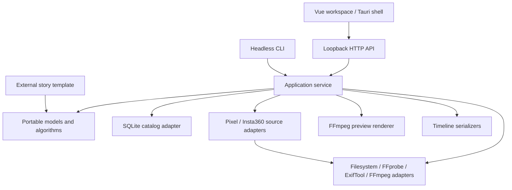

# Architecture

OpenFilm is a local media and story engine with multiple application entry points.
All edit quantities use seconds; originals are referenced and never rewritten by
import or composition. The engine produces decisions and operations that a preview
renderer or timeline exporter can consume.

The Desktop product layer uses stable Library/Story/Edit/Export workspace IDs,
Vue I18n catalogs and local preferences. UI locale never enters a domain state
discriminator or changes project content. Optional film locale/settings and
template/user text provenance stay in portable models; template packages supply
their own content catalogs. See [internationalization](i18n.md) and
[product workflow](product-workflow.md).

Application errors carry stable codes and parameters, with diagnostic detail
preserved for CLI/debug use. The frontend localizes the code at display time.
The same application import pipeline accepts native paths and validated browser
upload receipts. Uploads stream only to local project-managed sources, while
ordinary native imports continue referencing originals. MP4 export renders the
current composition into an atomic finished output rather than reusing a stale
preview. No new remote service or alternate composition engine is introduced.

Visual QA uses the same `OpenFilmApplication` and FFmpeg renderer as Desktop and
CLI. It snapshots the saved Composition revision, writes a unique MP4, manifest,
report and decoded sample PNGs under a mode-restricted project cache, and omits
source paths from the report. FFprobe and fresh SHA-256 comparisons bind the
samples to that render and its referenced sources. HTTP serves frames only by a
validated report/sample index; report polling is read-only and never creates a
cache directory. Cancellation removes partial artifacts, retry receives a new
identity, and revision/source changes cannot publish a current-looking result.
This workflow does not change project schema or execute project-authored code.
See [Visual QA validation](validation-visual-qa.md).

## Packages and boundaries

Film looks extend existing optional composition/clip content in schema 1.0.0.
Core owns immutable original recipes, validation and pure hierarchy resolution;
Solver owns protected look commands. Application persists them through ordinary
editing/retry/history contracts. The browser source adapter and FFmpeg renderer
share coefficients, with their distinct decode/transfer assumptions documented.
Render-only overrides are validated/copied before asynchronous work and stay
outside project history. Exporters retain look evidence rather than claiming NLE
color execution. The renderer records recipe checksums, actual build identity and
nullable catalog color metadata; Core gains no native dependency. See
[film looks](film-looks.md) and [source decisions](film-look-open-source-reference.md).

Scene-script review extends the existing generic `ReviewSuggestion` with a real
Story/beat/field target. `SceneScriptReviewService` in application owns the
whitelisted prompt, source binding, field-only mutation and retry; it calls the
same KnowledgeService/ProviderRegistry that owns language-provider consent.
Catalog schema v5 stores durable scene-script evidence separately from
transcript-targeted suggestions. The atomic project-file update includes a small
acceptance receipt alongside the changed script, allowing recovery across the
project-file/SQLite boundary. Desktop, HTTP and CLI use that shared service.
All existing-project manifest writes use the catalog's synchronous project-write
guard: compare the loaded owner's saved baseline and publish under the same
SQLite IMMEDIATE lock. Script acceptance joins its outer evidence transaction;
ordinary Story/timeline saves and close honor that lock too. Stale owners cannot
overwrite newer files during cleanup. This coordinates OpenFilm processes, while
observed out-of-band file changes still require reopening.
See [scene-script review](scene-script-review.md) for privacy and publication
contracts. It does not create another composition or timeline engine.

| Package           | Responsibility                                                                            |
| ----------------- | ----------------------------------------------------------------------------------------- |
| `core`            | Media, event, story, composition, project, and job models; schema validation/migration.   |
| `plugin-sdk`      | Extension ports/manifests and provider disclosure/consent validation.                     |
| `metadata`        | Portable capture timestamp resolution.                                                    |
| `events`          | Exact/perceptual groups and deterministic event clustering.                               |
| `story`           | Generic story construction and explainable offline ranking.                               |
| `solver`          | Composition, pure timeline commands, scoped beat regeneration and shortening suggestions. |
| `analysis`        | Portable AI provider registry with per-invocation consent/disclosure checks.              |
| `exporters`       | JSON, OTIO cut layout with metadata-only advanced edits/warnings, limited FCPXML and EDL. |
| `catalog`         | Node SQLite persistence, paginated descriptors and atomic source-location updates.        |
| `media`           | Local inspection, source matching/status, hashes and safe thumbnail/proxy conversion.     |
| `source-pixel`    | Pixel metadata/Motion Photo evidence and DNG inspection through existing source ports.    |
| `source-insta360` | Flat export metadata and original-source associations; raw/spherical preview limits.      |
| `render`          | Composition-to-FFmpeg adapter, local title rasterization and private render manifests.    |
| `application`     | Import/render/export orchestration, durable editing and relinking shared by CLI/API.      |
| `ui`              | Reserved package; current desktop helpers live in `apps/desktop`.                         |

Portable packages do not import Node, Vue, or Tauri. The application orchestrates
concrete local adapters through the same models; it deliberately avoids a general
dependency-injection framework. Scenario-specific language belongs to external
template packages. The first official template is registered by the application;
the SDK defines extension contracts, while arbitrary plugin discovery is future
work.

## Import and analysis

The 0.3 foundation adds portable transcript/word timing, waveforms, scenes and
generic markers to Core. `@openfilm/provider-whisper` implements the existing SDK
transcription port through optional local Python/faster-whisper. A user-supplied
model and GPU-to-CPU fallback leave Python/model installation optional for all
other workflows. Registry consent rules remain intact.

Catalog version 2 stores validated source-hash/version-bound intelligence outside
MediaAsset and project.json. Indexed transcript revisions support bounded reads;
failed/cancelled replacement preserves earlier results. Application operations
check source identity before reuse and successful commit and use existing durable
Jobs. Waveform decoding streams bounded peaks; scene detection downsizes frames.

Transcribe/waveform/scenes jobs carry optional execution ownership in existing
Job JSON. SQLite atomically reserves the project analysis slot, consumes the
exact queued checkpoint once and fences progress by owner/active state. Result
publication and completed Job status share the existing transcript/cache
transaction, including source and transcript revision guards. Only proven-dead
owners auto-recover; unknown or subsequently stopped owners have exact-checkpoint
confirmed recovery. Runtime cancellation capabilities belong to the server's
AbortController map. See [media-analysis recovery](media-analysis-recovery.md).

Application-layer provider waits share an abort boundary for transcription and
language review. Aborting settles the application wait even when the provider
ignores its signal; attached result/failure handlers still consume late settlement.
Transcription progress callbacks close with that wait, and existing abort checks
prevent validation/indexing of an obsolete result. The application and HTTP task
guards then release normally, preserving prior recognition until a validated
retry succeeds. ProviderRegistry still enforces disclosure and consent at invocation;
the SDK and SQLite schemas remain unchanged.

CLI, API and Desktop share these operations. Precision mode separates source and
composition seconds and applies snapping, trim and split through the existing
TimelineCommand history. Analysis does not rewrite Story or composition. See
[media intelligence](media-intelligence.md) and [reference decisions](vidscribe-reference.md).

Catalog v3 adds immutable transcript revision metadata, durable command receipts
and independent text undo/redo, portable project glossary entries and review
suggestions/batches. Core owns validated `TranscriptCommand` operations and
alignment state; application owns source verification, jobs and optional review
provider orchestration. Text edits never dispatch composition commands. Undo and
revision selection issue fresh tokens, protecting stale suggestion checks against
revision reuse. Accepted text commands and their suggestion audit commit in one
SQLite transaction. v1/v2 migrations retain original provider results and roll
back on failure.

Catalog v4 rebuilds only the transcript segment index inside the migration
transaction. JSON-encoded opaque ID keys avoid SQLite UTF-8 collisions for
isolated surrogate code units without changing original segment JSON, timings,
words, revisions, receipts or review evidence. v1/v2/v3 upgrades and malformed
legacy-data rollback share the same migration boundary.

Global terminology uses a validated, atomic, backed-up user-data file outside the
project. Trusted runtime options configure its path and an optional generic
LanguageProvider; project data and HTTP bodies cannot configure executables or
destinations. Bounded review prompts contain declared text/transcript context only.
The registry checks current disclosure and remote consent before every batch.
Completed batches remain durable on failure, cancellation and restart. Desktop
adds a paged Transcript mode within Edit rather than a second timeline engine.
See [text commands](transcript-editing.md), [terminology](glossary.md) and
[review evidence](review-suggestions.md).

Filesystem discovery yields supported file candidates lazily and avoids symlink
traversal. Import runs at most three file tasks concurrently. Each task inspects
media, normalizes metadata, fingerprints content, generates derived outputs, and
commits the catalog record. One malformed file becomes a structured job error
with its URI and stage instead of stopping the batch.

Completed files and cache outputs are reused on subsequent import. Hashes are
checked before and after processing so externally changing media is retried.
Preference edits survive reinspection. Interrupted queued/running jobs are marked
failed on reopen with an explicit reimport instruction; the process does not claim
to resume an in-flight decoder at an arbitrary byte offset.

Device adapters add namespaced metadata through existing source ports. Recognized
raw/spherical media and undecodable DNG remain catalog entries with actionable
preview limits; unsupported sources do not silently enter flat preview or automatic
composition. Supported HDR previews require known color metadata and FFmpeg tone
mapping filters. Original files and inspected metadata remain intact. See
[source support](source-support.md) for generated-fixture evidence and remaining
camera/hardware checks.

Analysis reads compact paged descriptors, then groups them in memory. It does not
decode all media or load complete EXIF/FFprobe blobs, but grouping still materializes
the descriptor collection and runs synchronously. Incremental analysis and
archive-scale worker/latency validation remain future work.

## Story and solver semantics

Candidates are partitioned chronologically by story creation. Ranking uses
observable user preference, dimensions, uniqueness, chronology, tags, and event
context; returned factors explain the score. No external model is used.

Selected IDs and must-include IDs are required in their beat; library locks are
required globally. Must-exclude and rejected media are ineligible. An asset can
appear once. Beat order is fixed; explicit selection/asset-order edges are retained,
and a chronological constraint can detect an incompatible manual order.

Automatic composition treats maximum durations, beat minima, source bounds and
inclusion as hard constraints. Targets are soft. Clips normally start from
4-second still/6-second motion pacing
and can stretch toward targets up to 12 seconds; hard minima can use longer still
holds or source durations. A playable clip has a minimum of one second or its
shorter source length. Unknown-duration moving/audio media cannot be required
without inspection. Candidate overlap and lock placement use bounded search;
complex search failures instruct users to narrow pools or pin selections.

The application caps a story scope at 2,000 candidates, including locks. Catalog
pagination supports larger libraries, but no 100,000-asset benchmark or unrestricted
story-scale guarantee is implied.

## Classified memories and scene-script planning

The scene-script slice extends `StoryBeat` with optional narration and visual
direction in `script`. Portable Story algorithms group a bounded source scope by
the first saved category tag or chronology and supply editable offline starters.
They use declared metadata, not inferred image contents. The film content locale
selects starter text; saved user script is independent of interface language.

The application binds current catalog source fields, project ID and film locale
in a source signature, owns scope validation and uses the existing solver's actual
preview. Planning does not rehash actual source-file bytes; rendering retains its
own source inspection. Each scene receives a playable minimum before remaining
time is allocated. Acceptance validates the reviewed Story, solves again
and atomically publishes a new Story/composition pair; it never treats a client
composition as executable authority. Durable receipt identity handles the exact
same acceptance retry while stale or changed proposals are rejected. API, CLI and
Desktop use this service rather than a second Vue-only planning engine.

This adds no media-analysis provider, generated speech, motion renderer or catalog
replacement. Script text remains Story content in the portable project. Scope,
duration, failure and regression requirements are recorded in
[scene-script planning](scene-script-planning.md); candidate verification is
tracked separately from the contract.

## Editing and source relocation

The solver applies pure commands to composition/story snapshots. The application
editor validates runtime command input, checks content revisions, persists a batch
before acknowledging it, and retains bounded undo/redo history for the open
project session. Validation or write failure preserves the previous document and
history. Clip locks and required-source constraints protect automatic changes;
manual over-limit cuts remain saveable, with rendering blocked until shortened.
The editor extends the current project model and application service. See
[editing contracts](EDITING_CONTRACTS.md).

The media adapter checks availability and proposes hash-first relink candidates.
The application owns bounded, expiring plans and revalidates selected files; the
catalog commits reference/location changes in one SQLite transaction while
preserving current user edits. Current roots live in
`metadata["openfilm.reference"]`, avoiding a JSON/SQLite transaction. Asset IDs and
timeline references survive relinking and subsequent import. Cache paths are
project-relative; location/cache changes do not invalidate timeline undo history.
Source availability is transient. Logical volume identity supports explicit
remounting, with physical-volume auto-detection deferred. See
[media portability](media-portability.md) and [relinking contracts](RELINK_CONTRACTS.md).

## Interchange boundaries

Composition subtitle export is a read-only derived use case alongside timeline
interchange. `core/captions.ts` maps saved source segments to the selected track's
clip instances. `exporters/captions.ts` serializes plain subtitles;
`application/captions.ts` owns source/revision checks, bounded snapshot reads and
atomic publication of file plus provenance. Desktop, HTTP and CLI reuse that
service. No caption-track model, history engine or catalog migration is added.
The CLI export session skips workspace recovery/repair and does not save project
JSON on close; it cannot overwrite another process's edit after a stale failure.
See [subtitle contracts](composition-captions.md).

OTIO carries native cut layout, source references, still holds, audio and gaps.
Advanced edits are preserved in OpenFilm metadata with explicit compatibility
warnings and an adjacent report. Speed edits use unretimed native excerpts and
padding where needed; NLE effects must be recreated manually. FCPXML and EDL keep
their existing restrictions. The official OTIO parser gate verifies structure,
timing and preserved metadata using generated real sources; it does not verify
Resolve import or playback. See [NLE compatibility](nle-compatibility.md).

## Local service and native shell

The HTTP adapter binds to `127.0.0.1` (port 4310 by default), validates Host/origin/write bodies,
and exposes project, catalog, job, story, timeline editing, relinking, preview and
export operations. Mutations are serialized; relinking and project replacement
are blocked while import/render jobs run. The Vue
workspace runs on port 1420 during development. Errors use non-success responses
with actionable text. Remote provider ports exist; the default application does
not instantiate a remote provider.

Desktop App owns the project/generation-guarded Activity snapshot. Transcript and
Suggestions consume this shared input instead of independently reading full job
history. The parent retains its existing poll, and older unfinished review jobs
remain available for recovery. Future job-history pagination must preserve those
recovery and fast-completion guarantees.

Tauri supplies native folder selection and can spawn a configured local Node
service, stopping its owned child on exit. It does not replace the Node media and
SQLite adapters. Development starts the service separately; deployment must
supply a verified runtime, service, media tools, and update/installer integration.

See [the integration contracts](CONTRACTS.md), [project format](project-format.md),
and [ADRs](adr/001-monorepo.md) for public interfaces and design decisions.

## Shared visual geometry contract

Clip visual geometry is a core-domain contract rather than an adapter-specific
interpretation. Coordinates use composition-frame pixels with the origin at the
frame center: positive x moves right and positive y moves down. A visual source
is contain-fit to the composition frame, then user scale and clockwise rotation
are applied around the actual fitted media center, x/y translation is applied in
frame pixels, and the result is clipped by the composition frame.

The desktop preview first fits an explicit composition-frame box into its viewport,
then independently contain-fits the decoded source aspect inside that frame. User
transforms apply to the fitted source box, not a letterboxed frame-sized element.
The frame box owns clipping, so translating or rotating beyond its edges matches
the renderer instead of leaking into spare UI space. Browser intrinsic dimensions
replace catalog dimensions after decode, keeping generated proxies and orientation
effects aligned with what the user is actually previewing.

The FFmpeg renderer follows the same ordering at output resolution. Its contain
fit uses decoded width/height and sample aspect ratio; positive SAR is preserved
as display aspect and unspecified SAR uses square pixels. It computes the output
size in one scale operation before normalizing SAR, without relying on a newer
FFmpeg `reset_sar` option or adding an intermediate resample. It converts
the transformed source to an alpha-capable format before rotation so transparent
rotated corners reveal lower visual tracks rather than becoming black. Final
encoding quantization remains pixel-based, while UI mapping may use fractional CSS
pixels. The contract is versioned as `CLIP_GEOMETRY_CONTRACT_VERSION` in
`@openfilm/core`.

This contract does not claim NLE interchange support. Exporters that cannot
faithfully represent a transform must continue to reject it or mark it metadata-only
rather than silently changing geometry.

The Story Edit monitor's aspect guides are display overlays only; they do not
change project output geometry or enter the render graph. Source stepping and clip
loop bounds use the selected asset's frame rate and edit range. Render overlays use
integer output-pixel positions and presentation timestamps rounded to the output
time base. See [monitor stability validation](validation-monitor-stability.md)
for the FFmpeg and browser regression evidence and the remaining workstation gate.

## Photo presentation and audio overlays

Photo-film quality extends the existing `Clip` with optional version-1 `layout`,
`motion`, `titleStyle` and `audioAutomation` fields. Existing schema-1.0.0 projects
without these fields retain their legacy behavior. The project JSON already owns
Composition content, so these additions need no catalog migration or second
timeline. Core validates them at runtime; the existing application editor and
solver commands own locks, revision checks, history, persistence and recovery.

Core's presentation plan resolves contain, focal/protected hero and explicit
two-photo diptych layouts in composition pixels. Source focal points and
protected rectangles use normalized display-oriented image coordinates. Unsafe
crop requests fall back explicitly to contain. A pure clip-local evaluator
resolves hold, push-in and pan at arbitrary seek times with declared easing and
bounded endpoints. The selected-photo monitor and FFmpeg adapter consume that
same plan; existing static transform controls remain on the normal geometry
path. Unsupported intentions are not silently promoted into rendered features.

Graphic title roles use a separate pure text-layout contract in Core. The local
Node renderer measures actual glyph advances using `fontkit` and rasterizes a
transparent PNG using `@resvg/resvg-js`. Preview and FFmpeg use that same raster,
including its resolved font, wrapping and placement. Font files stay local;
missing or unsupported glyphs produce explicit diagnostics. These graphic roles
do not rewrite transcript revisions, ASR word timing or derived SRT/WebVTT.
Optional `TitleStyle.fadeOut` and `bottomSafeMargin` extend the same version-1
style: Core owns clip-local opacity and visible text/scrim bounds. FFmpeg fades
only the RGBA title input before its timeline offset. Moving-photo previews use
their existing local clock; video title previews keep their animation clock in
a small overlay component, avoiding a new frame-by-frame timeline-parent render.
The inspector exposes the existing 400/700 weights and retains authored custom
weights. See [native text controls](native-text-controls.md).
`fontkit` and the platform-specific resvg native runtime are local Node/service
dependencies. The build keeps the resvg loader external so it can resolve its
installed platform package; Desktop receives the PNG and browser-safe layout
data, without bundling the native font/raster implementation.

Added music and imported narration use existing audio/music track types with
explicit `timing: "overlay"`. Their edits never ripple the visual story or extend
the existing film. Roles, fades, gain points and manual ducking live in the
Composition and use **clip-local timeline seconds**, rather than original source
time. A source-in trim changes the media heard underneath the same local
envelope; it does not attempt source-aligned envelope slicing. Shortening the
clip or film clamps automation to the new end. Speed changes also preserve the
local-timeline interpretation. Users can explicitly reconfigure the envelope
afterward. Splitting a clip with active fades, gain points or ducking is rejected
until a validated partitioning contract exists; copying one envelope to both
halves would create a different mix.

The renderer expresses this automation after source trim/speed conversion and
before timeline delay/mixing, using actual audio samples. A private
`<output>.manifest.json` sidecar records the Composition and its hash, actual
source hashes, resolved fonts, timing/encoding settings, fallback warnings and
output hash. Interchange retains new effects as OpenFilm metadata and reports
manual recreation where the target cannot express them. It does not equate OTIO
parser success with Resolve effect verification.

The generated twenty-second A/B workflow creates real MP4s, structural recipe
diffs, sampled frames and FFprobe/loudness/true-peak/RMS evidence. These prove
specific pipeline behavior and preserve private paths in local manifests; they
do not establish artistic quality or real speech clarity. See [the contract](photo-film-quality.md)
and [the execution record](validation-photo-film-quality.md) for scoped automated
results, candidate regression attempts and independent workstation gates.

## Scene directions to reviewed commands

`@openfilm/solver` compiles a small, exact clause vocabulary in a saved Story
scene's visual direction into existing photo layout/motion commands. The pure
proposal retains reasons, original evidence, before/after values and explicit
unsupported/conflict/unsafe notes. It never mutates the input, infers source
selection or calls a provider. Shared photo geometry validates effective movement.

The application's existing `TimelineEditor` binds a proposal to current scene,
composition, assets, project identity/directory, settings and recipe version.
Acceptance recompiles, validates the selected subset and persists the command
batch and versioned audit receipt together. Only request identity deduplicates an
uncertain retry; a new explicit request can re-adopt the same regenerated plan
after Undo. Saved-project checks under the catalog writer lock prevent stale
receipt acknowledgments after an external write. No generic save-baseline reset
or additional timeline engine is introduced.

Optional `sceneDirectionReceipts` live with Composition content in schema-1.0.0
project JSON, bounded to 100 with fail-closed capacity and runtime validation.
No SQLite migration is required. The passive preview normalizes already-moved
managed-source bookkeeping locally, without writing or weakening source freshness.
HTTP and CLI expose the same application boundary; executable commands from a
client are never trusted. Desktop retains pending acceptance identity locally and
uses a temporary monitor override for preview, outside autosave/history. See
[the contract](scene-direction-editing.md) and
[validation](validation-scene-direction-editing.md).

_Modified by OpenFilm contributors on 2026-10-18. Current OpenFilm first-party material is Apache-2.0; historical grants remain available. See LICENSE and NOTICE._

## Declarative GraphicScene

Optional version-1 `Composition.graphicScenes` uses core validation and a pure
Composition-time evaluator. Existing solver commands and application receipts own
history and persistence. A bounded Node raster adapter admits local still-image
byte snapshots and measured CJK text, then generates trusted numeric SVG/PNG.
Monitor requests current project/revision/output-frame PNGs through the application;
FFmpeg consumes the identical producer before native captions. There is no project
script/page execution or additional timeline. See the [contract](graphic-scenes.md)
and [threat model](security/graphic-scene-threat-model.md).

M5 / F03 adds optional per-node rotation, hidden and locked data to GraphicScene
v1; scenes without these fields retain their prior behavior. The Edit Monitor's
layer overlay derives geometry from the same evaluated Composition frame and
submits one existing `graphic.scene.upsert` through the timeline editor for each
gesture. The Inspector uses that command for opacity, z-order, visibility and
lock state. The solver protects locked node values, ancestor transforms and
scene timing/order at the command boundary. Monitor interaction is enabled only
for a paused, current saved-revision frame; project/composition key changes
unmount the editor and discard transient gestures. It does not add persistence,
renderer state or a second layer timeline.

## Creative Story Template Records

Optional schema-1.0.0 `Composition.graphicSceneTemplates` binds Conversation
Card, Route Story and Photo Relationship metadata to nodes in saved
`Composition.graphicScenes`. Builders in `@openfilm/story` emit ordinary
GraphicScene v1 Image/Text/Shape/Group data; metadata provides stable source
identity and template replacement context but cannot change the renderer's
primitive set. Application commands commit the scene and record atomically, and
scene removal clears its record. Existing Composition revisions own undo,
autosave and reopening. GPX is selected locally, size-bounded and parsed as
data-only UTF-8 XML; source assets remain read-only. See the
[template contract](creative-story-templates.md).

## M6 audio review and optional generation

`AudioQualityService` reuses the FFmpeg Renderer for original/stem/candidate MP4s
and measures decoded output. Review-bound volume commands validate evidence inside
`TimelineEditor.edit` and retain existing automation/history. CLI, HTTP and Edit
share this application boundary; see [audio quality](audio-quality.md).

`AudioGenerationService` calls the existing ProviderRegistry through the bounded
text-to-audio port. Preview and acceptance do not mutate the timeline. Explicit
import creates a managed WAV source; the editor accepts the catalog handoff only
if existing assets and documents are identical and exactly that new audio was
added. Matching history is preserved. The normal typed audio command then saves
through autosave/recovery. Durable accepted receipts preserve pending edit recovery
across restart; preview cache eviction does not revoke an already imported source.
See [provider generation](provider-generation.md) for consent, cost and threat model.

## M7A named project versions

`ProjectVersionService` is the shared application boundary for Desktop, HTTP and
CLI. It captures the saved project manifest and catalog image under the existing
project/catalog writer guard, validates their revisions, hashes referenced
sources, and stages a bounded immutable package under `versions/`. SQLite
serialization switches out of WAL only while an exclusive snapshot is held,
then restores WAL mode. A project with no version store remains valid schema
1.0.0. Version names and descriptions are mutable index metadata; the project
and catalog images are content-addressed immutable snapshot payloads.

Restore is project-level recovery, separate from TimelineEditor Undo/Redo. It
requires a matching current revision and explicit confirmation, revalidates the
target package/source hashes and current locks, and first captures the current
state as a named checkpoint. The catalog restore transaction publishes the
validated manifest with the catalog rows. A durable journal rolls back an
interrupted restore on next open; after success the application increments
project generation so Desktop discards stale editor state. Originals, render
outputs and caches are never copied or replaced. The version diff is a
deterministic structural comparison across existing Story, Composition,
CaptionCue, GraphicScene/template, audio automation and source identities. See
[Named Versions](named-versions.md) and its [validation record](validation-named-versions.md).

## M7D Collect Media packages

`CollectMediaService` is shared by Desktop, loopback HTTP and CLI. It selects
only saved Story/Composition references, hashes sources and resolved fonts,
requires explicit rights receipts, and binds each plan to the saved project and
catalog revision. The package writer captures the manifest and a SQLite-consistent
image under the catalog writer fence, filters unselected catalog rows and
VACUUMs the result so deleted asset data is not left in free pages. It excludes
versions, caches, jobs and credentials without changing project schema 1.0.0 or
the existing edit/history model.

ZIP and directory outputs use hash-addressed source/font files, private staging,
per-destination locks, source rehashing and revision checks before publication.
The verifier rejects unsafe paths, links, nested archives and invalid ZIP
records, unpacks into a private temporary root, validates receipts, reopens the
package, renders a preview and MP4, and decodes/checks the actual output. Font
lookup is package-relative and hash-checked when a collected project reopens.
The verifier reports representative render evidence for the first Composition;
cross-platform workstation and NLE checks remain manual. See the
[Collect Media contract](collect-media.md) and
[validation record](validation-collect-media.md).
