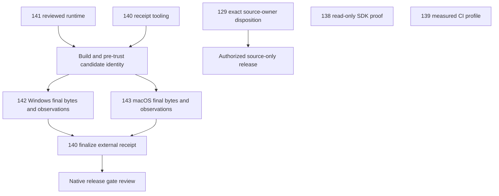

# Next-task audit and issue plan — 2026-11-11

## Snapshot and decision boundaries

This is a proposed execution order and an evidence-backed backlog, not feature
completion or release approval. It was checked against OpenFilm main
[`08e38b6a63a0b0fbcfd3a073c8bfa5dcc8c08224`](https://github.com/bynanci/open-film/commit/08e38b6a63a0b0fbcfd3a073c8bfa5dcc8c08224)
and Storytelling snapshot
[`b7fcf869d01727dcf408c457fdd42929dca80c7a`](https://github.com/bynanci/storytelling/commit/b7fcf869d01727dcf408c457fdd42929dca80c7a).
Re-read their current contracts before starting implementation; neither snapshot
is a forever-current API promise.

At the start of this audit, OpenFilm had one open issue (#7) and one open Draft
PR (#129). The baseline TASKS file had **28 unchecked entries**, including an
aggregate 4B entry duplicated by 4B.3 and several umbrella/sub-gates. This update
turns that aggregate into a pointer, leaving 27 boxes; this is not a count of
missing features. No manual observation or owner decision is checked off here.

Latest public release remains v0.4.0. Main's complete Verify, three-platform
Render QA and Windows recovery passed; scheduled dependency security run
[42657040633](https://github.com/bynanci/open-film/actions/runs/42657040633)
also passed on the same source. GLib source remediation and Tokio repair are
implemented; do not reopen them as unimplemented vulnerabilities. The retained
proc-macro-error maintenance warning still needs an owner-scoped disposition.

## Recommended next work

Choose focused engineering and distribution closure over new NLE surface area.

| Order                | Issue                                                   | Deliverable / readiness                                                                      |
| -------------------- | ------------------------------------------------------- | -------------------------------------------------------------------------------------------- |
| 1A                   | [#138](https://github.com/bynanci/open-film/issues/138) | Read-only producer/SDK compatibility capsule; ready without switching writers                |
| 1B                   | [#139](https://github.com/bynanci/open-film/issues/139) | Measured CI profiling; ready independently                                                   |
| 1C                   | [#140](https://github.com/bynanci/open-film/issues/140) | Versioned native evidence binding tooling; ready, actual closure follows OS evidence         |
| 2                    | [#141](https://github.com/bynanci/open-film/issues/141) | Reviewed per-target runtime artifact/run ID/manifest digest and license/SPDX closure         |
| 3A                   | [#142](https://github.com/bynanci/open-film/issues/142) | Windows signed package/trust/lifecycle evidence; blocked on runtime and pre-trust candidate  |
| 3B                   | [#143](https://github.com/bynanci/open-film/issues/143) | macOS signing/notarization/trust/lifecycle evidence; separate target gate                    |
| Parallel QA          | [#144](https://github.com/bynanci/open-film/issues/144) | Real dialogue/music listening; use existing Review/Accept and rendered audition              |
| Parallel QA          | [#145](https://github.com/bynanci/open-film/issues/145) | Existing warm runner plus separate installed cold/long-form measurements; gate-level results |
| Parallel owner/admin | [#146](https://github.com/bynanci/open-film/issues/146) | Concrete required-check/review/recovery policy; owner approval before settings writes        |

All nine issues have bounded acceptance and dependency sections. None is marked
implemented by creating the tracking item. They reuse existing Timeline,
Composition, Jobs, Mixer, provider contracts and native tools.

### Why this sequence

- A broad feature-expansion sprint would duplicate existing editing/analysis
  capabilities and delay verified delivery. Speed ramps, compound editing and
  multicamera stay deferred.
- Waiting for all workstations before doing any engineering would block safe,
  independent compatibility, profiling and receipt-contract work.
- The recommended parallel lanes complete useful code/proofs while target
  runtime, owner and workstation prerequisites are supplied. Final distribution
  acceptance stays after real observations.

The two appearances of #140 are staged outputs of one issue, not a dependency
cycle. Runtime provisioning freezes the manifest first; native shell and
post-build attribution receipts follow. A pre-trust candidate record stays
incomplete. OS trust/lifecycle observations are then bound in the external final
receipt; it must not require its own installer to embed that final receipt.
Source-only release decisions do not depend on completing native installers.

## Existing tracking retained

- **PR #129 — owner/release gate:** exact candidate
  `54534d8cf985203e8b5abbd09a771436f8fe09e5`, 19 checks passed, remains Draft.
  Technical readiness is not owner approval. Preserve the prepared source hash
  `40e170e682c1a518f16a572edddf0260247293c846986bd827582ba9b825e458` and bundle
  `bc5fc729f880d119330c9e31d7b3cbd73d320a91179d422a3c230cc1b97a2cb6`.
  Require the exact owner disposition, maintenance scope/expiry/recheck terms,
  fresh candidate audit before publication, and separately authorized merge/tag/
  publication. Current native-security artifact 13623121108 expires on
  2026-12-08 at 15:21 UTC; retain authenticated raw proof beyond CI retention.
- **Issue #7 — physical acceptance umbrella:** actual Resolve, ASR/LLM reference
  quality, GPU/CPU fallback, real camera sources, sustained 4K, display/input,
  cross-process recovery and cross-machine media remain open. Platform/audio/
  performance children do not close unrelated parent gates.
- **v0.6–v0.8:** keep separate historical source cuts and fresh candidate evidence
  in order after v0.5.0. No candidate is nominated here; do not retag current main
  several times. v1.0.0 remains the native distribution goal, not a requirement
  to implement every optional future capability.

## All unchecked baseline entries

Line links below bind the original inventory to the audited source, even when
this documentation update shifts current line numbers.

| Baseline TASKS line                                                                                      | Scope                                            | Classification                                               | Tracking / exit condition                                                                                                                                                                                                             |
| -------------------------------------------------------------------------------------------------------- | ------------------------------------------------ | ------------------------------------------------------------ | ------------------------------------------------------------------------------------------------------------------------------------------------------------------------------------------------------------------------------------- |
| [L50](https://github.com/bynanci/open-film/blob/08e38b6a63a0b0fbcfd3a073c8bfa5dcc8c08224/TASKS.md#L50)   | Tobi-ishi workstation/scale/keyboard/NLE         | Implemented; physical evidence open                          | #7 / [#145](https://github.com/bynanci/open-film/issues/145)                                                                                                                                                                          |
| [L180](https://github.com/bynanci/open-film/blob/08e38b6a63a0b0fbcfd3a073c8bfa5dcc8c08224/TASKS.md#L180) | Silence listening and workstation audition       | Implemented; real listening open                             | [#144](https://github.com/bynanci/open-film/issues/144)                                                                                                                                                                               |
| [L182](https://github.com/bynanci/open-film/blob/08e38b6a63a0b0fbcfd3a073c8bfa5dcc8c08224/TASKS.md#L182) | Additional media-intelligence providers          | Deferred admission; quality/rights/timing needed             | Later admission                                                                                                                                                                                                                       |
| [L193](https://github.com/bynanci/open-film/blob/08e38b6a63a0b0fbcfd3a073c8bfa5dcc8c08224/TASKS.md#L193) | Phase 4B aggregate                               | Duplicate pointer; only 4B.3 remains                         | 4B.3 below                                                                                                                                                                                                                            |
| [L205](https://github.com/bynanci/open-film/blob/08e38b6a63a0b0fbcfd3a073c8bfa5dcc8c08224/TASKS.md#L205) | Phase 4D long-form                               | Mixed; existing telemetry/runner, measurements open          | [#145](https://github.com/bynanci/open-film/issues/145)                                                                                                                                                                               |
| [L208](https://github.com/bynanci/open-film/blob/08e38b6a63a0b0fbcfd3a073c8bfa5dcc8c08224/TASKS.md#L208) | Compound editing 4E                              | Explicitly deferred                                          | Proven host + versioned single-Composition contract                                                                                                                                                                                   |
| [L211](https://github.com/bynanci/open-film/blob/08e38b6a63a0b0fbcfd3a073c8bfa5dcc8c08224/TASKS.md#L211) | Multicamera 4F                                   | Explicitly deferred                                          | Host proof + synchronization/provenance                                                                                                                                                                                               |
| [L218](https://github.com/bynanci/open-film/blob/08e38b6a63a0b0fbcfd3a073c8bfa5dcc8c08224/TASKS.md#L218) | Speed ramps 4B.3                                 | Explicitly deferred; not visual keyframes                    | Source-mapped caption/audio/rhythm + audio policy                                                                                                                                                                                     |
| [L276](https://github.com/bynanci/open-film/blob/08e38b6a63a0b0fbcfd3a073c8bfa5dcc8c08224/TASKS.md#L276) | Source release-owner disposition                 | Decision; candidate technical checks passed                  | [PR #129](https://github.com/bynanci/open-film/pull/129)                                                                                                                                                                              |
| [L282](https://github.com/bynanci/open-film/blob/08e38b6a63a0b0fbcfd3a073c8bfa5dcc8c08224/TASKS.md#L282) | Storytelling next milestone                      | Stale M1-next wording; bounded scopes now accepted           | [#138](https://github.com/bynanci/open-film/issues/138); SDK production M3-03 remains external                                                                                                                                        |
| [L286](https://github.com/bynanci/open-film/blob/08e38b6a63a0b0fbcfd3a073c8bfa5dcc8c08224/TASKS.md#L286) | D7B/M7E native distribution                      | Mixed code/evidence/OS gates                                 | [#140](https://github.com/bynanci/open-film/issues/140) / [#141](https://github.com/bynanci/open-film/issues/141) / [#142](https://github.com/bynanci/open-film/issues/142) / [#143](https://github.com/bynanci/open-film/issues/143) |
| [L304](https://github.com/bynanci/open-film/blob/08e38b6a63a0b0fbcfd3a073c8bfa5dcc8c08224/TASKS.md#L304) | Clean native install and first use               | Target QA blocked on candidates                              | [#142](https://github.com/bynanci/open-film/issues/142) / [#143](https://github.com/bynanci/open-film/issues/143)                                                                                                                     |
| [L309](https://github.com/bynanci/open-film/blob/08e38b6a63a0b0fbcfd3a073c8bfa5dcc8c08224/TASKS.md#L309) | Signing/notarization/update/rollback/uninstall   | Trust configuration and target observations                  | [#142](https://github.com/bynanci/open-film/issues/142) / [#143](https://github.com/bynanci/open-film/issues/143)                                                                                                                     |
| [L313](https://github.com/bynanci/open-film/blob/08e38b6a63a0b0fbcfd3a073c8bfa5dcc8c08224/TASKS.md#L313) | First-open repetitions / one-hour memory         | Existing runner; observations missing                        | [#145](https://github.com/bynanci/open-film/issues/145)                                                                                                                                                                               |
| [L328](https://github.com/bynanci/open-film/blob/08e38b6a63a0b0fbcfd3a073c8bfa5dcc8c08224/TASKS.md#L328) | Native multi-source pickers and external storage | Implemented; Windows/macOS QA open                           | #7; relevant [#142](https://github.com/bynanci/open-film/issues/142) / [#143](https://github.com/bynanci/open-film/issues/143)                                                                                                        |
| [L330](https://github.com/bynanci/open-film/blob/08e38b6a63a0b0fbcfd3a073c8bfa5dcc8c08224/TASKS.md#L330) | Windows #66–#68 follow-up                        | Code fixes exist; physical workflow QA open                  | #7 / [#142](https://github.com/bynanci/open-film/issues/142)                                                                                                                                                                          |
| [L332](https://github.com/bynanci/open-film/blob/08e38b6a63a0b0fbcfd3a073c8bfa5dcc8c08224/TASKS.md#L332) | Actual NLE handoff                               | Real target-editor evidence missing                          | #7 Resolve gate; not SDK finite FilmCraft proof                                                                                                                                                                                       |
| [L334](https://github.com/bynanci/open-film/blob/08e38b6a63a0b0fbcfd3a073c8bfa5dcc8c08224/TASKS.md#L334) | Camera media                                     | Real Pixel/Insta360 evidence missing                         | #7 camera gate                                                                                                                                                                                                                        |
| [L336](https://github.com/bynanci/open-film/blob/08e38b6a63a0b0fbcfd3a073c8bfa5dcc8c08224/TASKS.md#L336) | Playback/input/display/4K/GPU                    | Physical measurements missing                                | #7 / [#145](https://github.com/bynanci/open-film/issues/145)                                                                                                                                                                          |
| [L338](https://github.com/bynanci/open-film/blob/08e38b6a63a0b0fbcfd3a073c8bfa5dcc8c08224/TASKS.md#L338) | Audio/ASR/TTS/model quality                      | Human/device/reference evaluation open                       | #7 / [#144](https://github.com/bynanci/open-film/issues/144) (Silence scope only)                                                                                                                                                     |
| [L340](https://github.com/bynanci/open-film/blob/08e38b6a63a0b0fbcfd3a073c8bfa5dcc8c08224/TASKS.md#L340) | Creative output/editorial quality                | Human representative-film evaluation open                    | #7 creative checklist                                                                                                                                                                                                                 |
| [L342](https://github.com/bynanci/open-film/blob/08e38b6a63a0b0fbcfd3a073c8bfa5dcc8c08224/TASKS.md#L342) | Cross-machine Collect/portability                | Implementation exists; target filesystem QA open             | #7 portability checklist                                                                                                                                                                                                              |
| [L367](https://github.com/bynanci/open-film/blob/08e38b6a63a0b0fbcfd3a073c8bfa5dcc8c08224/TASKS.md#L367) | Executable plugin discovery/loading              | Unimplemented, deliberately later                            | Keep data-only presets; threat model first                                                                                                                                                                                            |
| [L369](https://github.com/bynanci/open-film/blob/08e38b6a63a0b0fbcfd3a073c8bfa5dcc8c08224/TASKS.md#L369) | Additional vision/embedding/language adapters    | New implementations later; interfaces/Whisper exist          | Evidence-led provider admission                                                                                                                                                                                                       |
| [L371](https://github.com/bynanci/open-film/blob/08e38b6a63a0b0fbcfd3a073c8bfa5dcc8c08224/TASKS.md#L371) | Archive incremental analysis/scheduling          | Genuine later code gap; existing Jobs/proxy workers retained | Measure end-to-end archive bottleneck first                                                                                                                                                                                           |
| [L400](https://github.com/bynanci/open-film/blob/08e38b6a63a0b0fbcfd3a073c8bfa5dcc8c08224/TASKS.md#L400) | Signed installed cold startup                    | Evidence missing; warm checkout runner is narrower           | [#145](https://github.com/bynanci/open-film/issues/145)                                                                                                                                                                               |
| [L403](https://github.com/bynanci/open-film/blob/08e38b6a63a0b0fbcfd3a073c8bfa5dcc8c08224/TASKS.md#L403) | Further NLE alpha/editable baked effects/stems   | Genuine later capability gap                                 | Actual target-editor proof before expansion                                                                                                                                                                                           |
| [L405](https://github.com/bynanci/open-film/blob/08e38b6a63a0b0fbcfd3a073c8bfa5dcc8c08224/TASKS.md#L405) | Remote image-to-video                            | Disabled intentionally; evaluation deferred                  | Verified APIs/consent/cost/rights/identity evidence                                                                                                                                                                                   |

## Storytelling boundary and ownership

M1-01/M1-02, the finite synthetic M1-03 FilmCraft proof, bounded M2, M3-01
review binding and M3-02 journal are accepted in their stated profiles. Production
M3-03 remains open despite merged test-only lost-reply proof: trusted approval,
production executor, in-flight timeout/quiescence and safe NotApplied retry must
be demonstrated. The test loses the reply after successful host exit, not while
the host is still executing. M4's TypeScript client/one OpenFilm feature flag
must wait for that production boundary.

OpenFilm owns the producer fixtures, compatibility capsule, media UI and existing
editing authority. Storytelling owns its planner/journal/executor contracts and
existing 48-item/16-gap migration ledger. No second transfer ledger is created.
The capsule may consume existing SDK CLI contracts without adopting execution
or Catalog-write authority. Complete proposal JSON + snapshot + strict context
are separate review inputs; importer output is not a planner proposal.

The admitted finite profile is narrower than current OpenFilm projects: one
contiguous Video track at 1x. Audio/embedded audio, transforms, effects, user
pins/overrides and animation outside that contract must be rejected explicitly,
not silently dropped. FilmCraft v0.18.0 Linux/25fps synthetic CPU proof does not
establish general audio/NLE, Resolve, hardware or editorial fidelity. Source
provenance, Apache-2.0/MIT notices and compatibility versions remain mandatory.

References: [SDK accepted history](https://github.com/bynanci/storytelling/blob/b7fcf869d01727dcf408c457fdd42929dca80c7a/docs/delivery/VIDEO_TASK_HISTORY.md#L101),
[finite profile](https://github.com/bynanci/storytelling/blob/b7fcf869d01727dcf408c457fdd42929dca80c7a/docs/migration/FINITE_V1.md),
[review CLI](https://github.com/bynanci/storytelling/blob/b7fcf869d01727dcf408c457fdd42929dca80c7a/docs/migration/PLANNER_OTIO_REVIEW_V1.md),
[production boundary](https://github.com/bynanci/storytelling/blob/b7fcf869d01727dcf408c457fdd42929dca80c7a/docs/migration/M3-03-ISOLATED-FILMCRAFT.md).

## Verification and closure rules

- New product work needs focused regressions plus applicable full CI at its
  exact final source; actual media changes retain real FFmpeg/decode evidence.
- A Windows/macOS record validator verifies structure, not observations. Use
  actual source/runtime/package hashes and preserve failed/blocked attempts.
- The existing warm-cache checkout-built benchmark prehashes/copies fixtures and
  prestarts its service. It cannot establish signed installed single-click cold
  startup. Use a separate external tracer and hash afterward for that claim.
- Keep PCM/WAV parity separate from lossy AAC MP4 decode and human listening.
  Record audio device/routing/channels/sample rates and predeclared criteria.
- Direct main metadata reports `protected: false`, with no repository Rulesets.
  Restricted protection, alert and signing-secret details remain HTTP 403 and
  unknown. This plan makes no administrative changes and asks for no secret.
- This PR changes documentation only. No additional implementation, native
  execution, signing, release-owner acceptance or publication is claimed.
