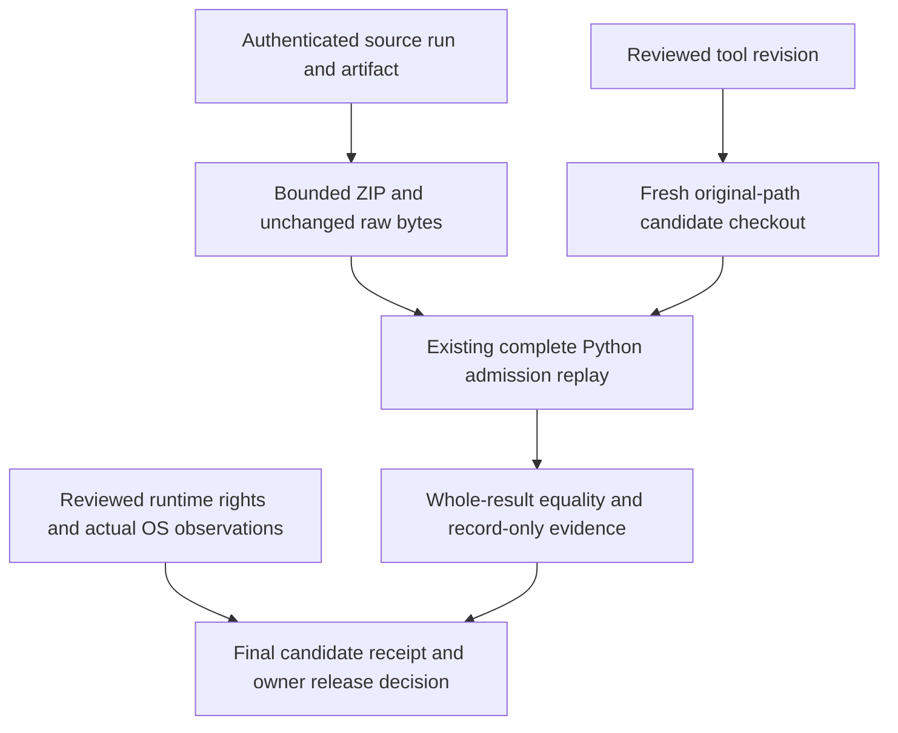

# Native candidate evidence binding — issue 140

Status: tooling implemented; real distribution acceptance remains blocked by reviewed runtime inputs, final signed installers, target OS observations and independent review. Fixture tests establish rejection behavior only. Every output has `distributionApproved: false`. A complete record is not a signature, a rights grant, or owner authorization to distribute.

## Version 1 and the signing boundary

The executable contract is `scripts/native/receipt-contract.ts`; the finalizer is `scripts/native/receipt.ts`. All file pins contain `{path, sha256, size}`. Paths are relative to one selected repository/evidence root. Preserve source and build inputs under that root. Do not move mutable artifacts after pinning them.

The graph is acyclic:

```text
reviewed fixed embedded runtime + compiler/installer bytes
  -> candidate.json (native-candidate-identity, incomplete)
  -> signing/packaging -> final-bytes.json (native-final-bytes, incomplete)
  -> candidate-specific security / trust / lifecycle observations
  -> independent review of exact pinned subjects
  -> final external candidate receipt (evidence-complete-record-only)
```

The embedded `runtime-manifest.json` never incorporates shell, installer, or final receipt hashes. Its bytes must remain identical throughout. Candidate identity binds the full source commit, platform, architecture, target triple and ABI, embedded manifest, shell and installer inventory. Signing may change shell/installer hashes, but not their paths/inventory or the runtime manifest. `seal` captures those final bytes. If signing, stapling, repackaging or any other byte change happens afterwards, create a new final-bytes file and repeat all observations/review. Never reuse observations against an old final-artifact digest.

Preserve the original compiler output and Cargo-generated files before signing. Stage the shell/installer copies for signing separately, with the same pre-signing shell hash. Native attribution is recomputed against the original build tree and bound to the pre-trust shell. Final linkage and OS observations cover the post-signing bytes. Review must confirm that signing/packaging is the only intended transition and that the installed shell and embedded manifest match the pinned final identities.

## Commands and input contracts

Run from the candidate checkout after the existing native build:

```sh
pnpm exec tsx scripts/native/receipt.ts
pnpm exec tsx scripts/native/receipt.ts seal . apps/desktop/src-tauri/target/release/bundle/candidate.json apps/desktop/src-tauri/target/release/bundle/final-bytes.json
```

Before pinning, the default command checks that its candidate output is absent. If Cargo hardlinked the known `target/release/openfilm-desktop` (or `.exe`) to `release/deps`, it reads that regular build output through a bounded handle, creates an exclusive sibling copy, verifies unchanged source identity and exact bytes/mode, then atomically replaces only that same release path. The compiler alias retains its original bytes; the release path becomes an unlinked signing subject. The manifest and original contribution IDs/hashes do not change. There is no unlink fallback if atomic replacement fails (including Windows sharing violations); no candidate is emitted on a staging failure. The workflow's shell upload path and later `seal` subject remain the same. This operation is restricted to the default build output; explicit `identity` inputs and all general evidence pins still reject hardlinks and aliases. Preserve the complete original compiler evidence before later signing as described above.

The first command writes an exclusive `candidate.json` in the existing bundle directory, using the runtime linkage baseline ABI and native release executable. The workflow retains both incomplete records, the fixed runtime manifest, runtime SPDX and frontend/service build contributions with its installer archive. It does not invent missing Cargo, platform or review evidence. Default workflow snapshots are unsigned unless the build actually signed them; the incomplete records are not OS trust observations.

For an explicit staged shell (including a signed macOS bundle executable), use:

```sh
pnpm exec tsx scripts/native/receipt.ts identity . dist/native-evidence/identity-inputs.json dist/native-evidence/candidate.json
pnpm exec tsx scripts/native/receipt.ts seal . dist/native-evidence/candidate.json dist/native-evidence/final-bytes.json
pnpm exec tsx scripts/native/receipt.ts finalize . dist/native-evidence/finalization-inputs.json dist/native-evidence/final-candidate.json
```

`identity-inputs.json` contains `candidateSha`, `target` (`platform`, `architecture`, `triple`, `abi`), `runtimeRoot`, `shellPath` and `installerPaths`. `candidateSha` must equal the checkout HEAD. Supported triples are x86_64/aarch64 with unknown-linux-gnu, apple-darwin or pc-windows-msvc. ABI must exactly match reviewed native linkage at finalization.

`finalization-inputs.json` contains `schemaVersion: 1` and file pins named `candidate`, `finalBytes`, `attribution`, `finalLinkagePolicy`, `finalLinkage`, `security`, `trust`, `lifecycle`, `review`. Output files must be new and outside the embedded runtime. These are external local records; no upload occurs.

`attribution` points to an object with `schemaVersion: 1`, root-relative `targetDirectory`, and pins `report`, `spdx`, `buildContributions`, `cargo`, `cargoInputs`, `licenseReceipts`, `nativeRuntimeInputs`, `nativeLinkage`. Reuse `cargo-attribution.ts` and `attribute-distribution.ts` to produce the originals. Retain actual Cargo metadata/messages/invocation/lock, compilations, generated outputs, static-library inventories, Rust sysroot inventory, full license texts and obligations, original linkage, and report notice/receipt copies. Source paths may be relative or absolute inside the selected root; outside-root inputs are rejected. `cargoInputs` pins a version-1 object with `target`, root-relative `targetDirectory`, and file pins `metadata`, `messages`, `lock`, `invocation`, `shell` for the original Cargo collector inputs. The target and original shell must match the candidate, and every role is required. The finalizer reruns `collectCargoEvidence` and compares the entire derived Cargo inventory, including generated outputs and static link directives, before recomputing attribution through the existing contribution validator and compares the report and SPDX, rather than trusting a ready-status string. Any existing blocker fails finalization.

For cross-host replay, `cargoInputs` may additionally contain this **data-only** `pathMapping` (no executable code):

```json
{
  "syntax": "win32",
  "repositoryRoot": "C:/agent/open-film",
  "targetDirectory": "C:/agent/open-film/apps/desktop/src-tauri/target",
  "externalRoots": [
    {
      "originalRoot": "D:/cargo/registry/src",
      "localRoot": "dist/native-evidence/cargo-registry"
    }
  ]
}
```

`syntax` is `win32` or `posix`, independent of the finalization host. Windows drive paths with either separator are supported; UNC/device paths, relative paths, traversal, duplicate separators, reserved names and ambiguous case aliases are rejected. The original repository root projects to the selected local repository, preserving the original repository-relative source and raw-input layout. The original target directory must project exactly to `cargoInputs.targetDirectory` and match the pinned metadata's original `target_directory`. External source/build roots project only to their declared bounded local directories. Original roots cannot overlap; external local destinations cannot overlap, and their prefixes are reserved against the implicit repository projection. Unknown original roots fail closed.

The resolver changes **only where the collector reads files**. Original metadata/messages, raw package IDs, resolved-ID hashes, raw-role hashes and original source identities are not rewritten. Existing workspace locator normalization still uses the same original repository-relative path; workspace sources outside the original repository remain rejected. External registry identities retain their original registry locator, lock checksum and complete verified source-tree inventory. Place external retained trees outside workspace package trees, so adding a capsule does not change their original source inventory. The same complete collector then reconstructs and compares the entire Cargo receipt, including generated outputs and static links. Symlinked local parents and missing/changed retained bytes fail; no host path guessing, global path overrides or caller-supplied JavaScript runs. Omitting `pathMapping` preserves the previous native-host collection/replay behavior.

`finalLinkagePolicy` and `finalLinkage` use the existing linkage contract, but binary paths are relative to the selected root and must include the final shell. All listed binary bytes, tool executions, policy identity, target, reviewed OS baseline and ABI must match. This is separate from the pre-signing attribution linkage.

## OS/security observation contract

Each `security`, `trust` or `lifecycle` pin references an object with exactly:

- `schemaVersion: 1`, `kind` matching its role.
- `candidateSha`, `candidateIdentitySha256` (raw candidate.json SHA-256), `finalArtifactsSha256` (from final-bytes.json), and exact `target`.
- `observationMode: "executed"`, `status: "passed"`.
- `observedAt` in `YYYY-MM-DDTHH:mm:ss.sssZ`, `observer`, `tool`, `toolVersion`.
- `checks` and a nonempty `raw` array of pinned actual evidence files.

Required checks:

| Role      | Required check names                                                |
| --------- | ------------------------------------------------------------------- |
| security  | source-admission, post-build-scan, dependency-closure               |
| trust     | signature, publisher, os-trust                                      |
| lifecycle | install, launch, close, reopen, uninstall, original-media-preserved |

Security must include exactly one raw file named `admission.json`, produced by
the existing native source-admission workflow for the same candidate. The
validator requires passing source remediation, no reasons, all four closure
digests and three audit report identities. Retain exactly one each of
`source.json`, `closure.json`, `regression.json`, `metadata.json`, `audit.json`,
and the stdout/stderr files named by all three audit reports in `security.raw`.
Also retain `actual-metadata.stdout`, `current-registry-metadata.stdout`,
`current-registry-Cargo.lock`, `historical-Cargo.lock`, and the ordinary
`audit/advisory-db.bundle` and `audit/advisory-db.shallow` files. All original
roles remain required even when summary flags say they passed: **17 payload
files**, or **18 pins** including `admission.json` in a minimal observation.
Extra raw observations do not replace any required role.

### Audit capture v2 and faithful database restoration

New policy requires integer audit `schemaVersion: 2` and a required `dbSnapshot`
with format `git-shallow-bundle-v1`, the exact HEAD root tree, and size/SHA-256
pins for fixed leaves `advisory-db.bundle` and `advisory-db.shallow`. The sidecar
contains the **original** single HEAD SHA-1 plus LF bytes read from the real
depth-one database; it is not generated from receipt metadata. The producer
checks the original clean database state before and after the three unchanged
scans and retains both ordinary files without another fetch. Unknown, incomplete
or downgraded formats fail closed.

The shared auditor validates those bytes and restores them only into a newly
created private bare clone. It requires the expected HEAD/tree, exact original
boundary, shallow status and successful ordinary
`git --no-replace-objects fsck --full --no-reflogs`. A missing parent beyond the
captured shallow boundary is legitimate; a missing current tree/blob is not.
Caller Git overrides, config, hooks, external object stores and lazy fetch cannot
supply missing objects. Source/candidate repositories and original artifacts are
never repaired, unshallowed or retimed by replay.

Historical v1 captures remain immutable and tied to their exact original policy
authority. Their bundle-only bounded snapshot result is not a new v2/fsck pass.
New tools do not infer a missing boundary or offer a caller-selected legacy mode;
the existing six-file tool/subject identity gate remains mandatory. A candidate
with changed policy needs its own fresh v2 capture and actual replay.

The finalizer materializes original pinned bytes and calls the same complete
`verify_admission` function as the original native-admission CLI. This includes
source checkout cleanliness, exact candidate/lock identity, both metadata
graphs, registry and historical locks, captured database state, raw scans,
closure and freshness. The entire result must equal the original receipt.
Original JSON bytes, including Python float representations, remain unchanged.
Put evidence and local input configs in an already ignored directory such as
`dist/native-evidence`; untracked source files block admission.

Replay requires Linux and the **original absolute POSIX source-admission checkout
path**, matching the existing source verifier. Preflight checks the original
metadata workspace and root/GLib manifest paths before database restoration or
full admission. Arbitrary-root replay is unsupported; the independent Cargo path
mapping does not relocate source-admission metadata. Retain Windows/macOS target
observations and perform external final assembly on an isolated Linux runner
with that exact candidate/path and unchanged artifact bytes. Preserve the complete
original artifact for independent review. Source admission alone does not satisfy
post-build scan or target dependency-closure checks. Security must be fresh
within six hours of finalization; future observation timestamps fail.

### Source-only hosted replay

The opt-in `Retained native source replay` workflow reuses the existing complete Python
`receipt-security.py` authority on a fresh Linux runner. It is a source-evidence
check, independent of runtime provisioning, signing and platform observations.
The workflow must first be reviewed and registered on main. It does not replace
or alter automatic source admission, final receipt assembly or owner approval.

Source transport also authenticates the producer workflow reference. A reusable
PR workflow pointing to a merge commit instead of the exact candidate is rejected
even when its producer checks pass. The directly registered native-security.yml
producer is supported for a reviewed exact-candidate capture; a reusable security
workflow must retain the exact candidate native-workflow identity. Keep rejected
artifacts unchanged. See the [actual v2 capture/replay evidence](validation/native-v2-replay-2026-11-12.md).

Supply all five values from the same reviewed successful source capture:

| Input                   | Required identity                                              |
| ----------------------- | -------------------------------------------------------------- |
| `candidate_sha`         | Full exact source commit, including the original policy bytes  |
| `source_run_id`         | Completed successful same-repository capture run               |
| `source_workflow_id`    | Authenticated producer workflow, not a caller URL              |
| `source_artifact_id`    | Unexpired `native-security-<candidate>` artifact from that run |
| `source_archive_sha256` | Independently reviewed original ZIP digest                     |

From an existing authenticated repository session, validate the reviewed tool
revision on main and the original successful source capture before dispatching.
No token is pasted into inputs or stored in a project:

```sh
: "${OPENFILM_REPLAY_CANDIDATE:?full reviewed original source SHA required}"
: "${OPENFILM_REPLAY_SOURCE_RUN:?original successful source run ID required}"
: "${OPENFILM_REPLAY_SOURCE_WORKFLOW:?original producer workflow ID required}"
: "${OPENFILM_REPLAY_SOURCE_ARTIFACT:?original artifact ID required}"
: "${OPENFILM_REPLAY_ZIP_SHA256:?independently reviewed original ZIP hash required}"
gh workflow run native-security-replay.yml --repo bynanci/open-film --ref main \
  -f candidate_sha="$OPENFILM_REPLAY_CANDIDATE" \
  -f source_run_id="$OPENFILM_REPLAY_SOURCE_RUN" \
  -f source_workflow_id="$OPENFILM_REPLAY_SOURCE_WORKFLOW" \
  -f source_artifact_id="$OPENFILM_REPLAY_SOURCE_ARTIFACT" \
  -f source_archive_sha256="$OPENFILM_REPLAY_ZIP_SHA256"
```

Retain the actual dispatch run ID and its `native-source-replay-<candidate>-<run>`
artifact. A passing `result.json` records `source-replay-verified`, the distinct
tool/subject identities, input and output digests and `distributionApproved:false`.
Failure diagnostics must remain bounded and sanitized; never attach credentials,
signed transport URLs or private media to a debugging report.



The dispatcher/tool revision and historic subject revision are recorded separately.
The six existing Python policy files must match the subject byte-for-byte. The
runner authenticates repository/run/workflow/head/artifact identities, bounds and
hashes the transport, preserves all original raw bytes, and prepares only the
fresh allowed original POSIX checkout. Existing/dirty/symlink workspaces are
refused without resetting or deleting them. Hooks/filters and artifact execution
are not enabled. A signed-storage redirect never carries the GitHub API token.

A successful Python process is insufficient: its entire admission result must
match the original retained receipt. Original byte, path, graph, lock, database,
scan and six-hour freshness requirements remain. An expired but downloadable
artifact must fail; this workflow does not refresh timestamps, substitute scans
or retry until passing. Retain the actual failed/successful run, exact source/tool
SHA, input identities and result artifact for independent review before reporting
external replay complete. Fixture tests alone cannot establish that observation.
No result grants native trust, rights or distribution approval.

### Safe independent Linux assembly

Review the original `metadata.json` and explicitly select the original checkout path (its workspace path ends in `apps/desktop/src-tauri`); also check the root and GLib manifest paths. Treat all three as evidence to review, never as permission to create or overwrite arbitrary paths. Use a fresh isolated Linux runner/container whose filesystem you control. If that exact path is occupied, dirty, a symlink, or contains the wrong candidate, stop and provision a new isolated runner. Do not move, delete, reset or reuse an existing checkout to satisfy this constraint. The operational cost is recreating the reviewed original path for external assembly; pinned metadata and package IDs must never be edited to fit a convenient directory.

After choosing explicit reviewed values, this guarded sequence creates a new checkout only (the source URL and full candidate SHA must come from the authenticated handoff):

```bash
set -eu
umask 022
ORIGINAL_ROOT=/reviewed/original/absolute/checkout
CANDIDATE_SHA='<reviewed-full-candidate-sha>'
SOURCE_URL='<reviewed-source-url>'
# Require an unused path and ordinary, already provisioned parent directories.
python3 - "$ORIGINAL_ROOT" <<'PY'
from pathlib import Path
import sys
root = Path(sys.argv[1])
assert root.is_absolute() and str(root) == sys.argv[1] and root == root.resolve(), "review an absolute canonical path"
assert not root.exists() and not root.is_symlink(), "occupied checkout path; use a new isolated runner"
for parent in root.parents:
    assert parent.is_dir() and not parent.is_symlink(), "unsafe or missing parent; provision the isolated runner first"
PY
git clone --no-checkout -- "$SOURCE_URL" "$ORIGINAL_ROOT"
git -C "$ORIGINAL_ROOT" checkout --detach "$CANDIDATE_SHA"
test "$(git -C "$ORIGINAL_ROOT" rev-parse HEAD)" = "$CANDIDATE_SHA"
test -z "$(git -C "$ORIGINAL_ROOT" status --porcelain --untracked-files=all)"
```

Copy the independently authenticated artifact/input files into the fresh checkout's already ignored `dist/native-evidence` directory, preserving their bytes; install the frozen tool dependencies in the fresh checkout as documented by the repository, and invoke finalization using this checkout as `<root>`. Keep the downloaded original artifact separately for review. The finalizer still applies all source cleanliness, Linux mode, lock, metadata, raw report, database commit, candidate and freshness checks. If these checks fail, stop; never repair evidence by rewriting its contents or setting optimistic status flags. The offline regression transfers an archive that excludes hidden files, deletes its private synthetic producer checkout, and replays through the real TypeScript/Python bridge from a fresh independent checkout at the recorded temporary path. This proves the structural handoff only, not a real security observation or distribution approval.

OS trust must retain actual Authenticode/SmartScreen or codesign/notarization/Gatekeeper results as applicable, publisher identity, final byte identities and installed embedded-runtime comparison. Physical/interactive prompts and install/close/uninstall behavior must be observed on the declared target. `unavailable`, `not-run`, fixture observations and empty logs cannot be relabeled as passing. Signing credentials and rights are never generated by this tool.

`review` references `schemaVersion: 1`, `kind: "native-candidate-review"`, the same candidate/identity/final-artifact/target fields, `disposition: "reviewed"`, `observationMode: "executed"`, `reviewer`, `reviewedAt`, `subjects`, and nonempty pinned `raw`. `subjects` must exactly equal the eight pins other than review in finalization inputs. The reviewer must differ from the observers, and review must follow every observation. Retain the authenticated review source; this local validator checks bindings and completeness, not the real-world authenticity of an operator's identity or OS log. Distribution authorization remains a separate owner decision.

## Bounds and verification

JSON/raw evidence is limited to 8 MiB per file; shell/installers to 4 GiB each and 8 GiB total, with at most 16 installers. Inputs reject traversal, drive/UNC paths, reserved names, symlinks, hardlinks, stale hashes and sizes. Reads compare the regular-file handle and current path and bound bytes during hashing. Contributions and directory traversal have inventory limits. For this strict boundary, copy contributing package/license files from hardlinked caches into an isolated input tree before finalization; their original paths and hashes remain bound by contribution receipts. Outputs are exclusive; no embedded self-hash or overwrite is allowed.

Tests cover actual temporary files and signed-byte replacement, unchanged runtime manifest, candidate/target mismatch, missing/tampered/oversized/path-abusive evidence, incomplete/fixture observations, independent review subjects, security admission and post-seal artifact mutation. Valid synthetic structure remains record-only and a test-only runtime cannot finalize. Tests do not claim successful Windows/macOS execution or distribution acceptance.
