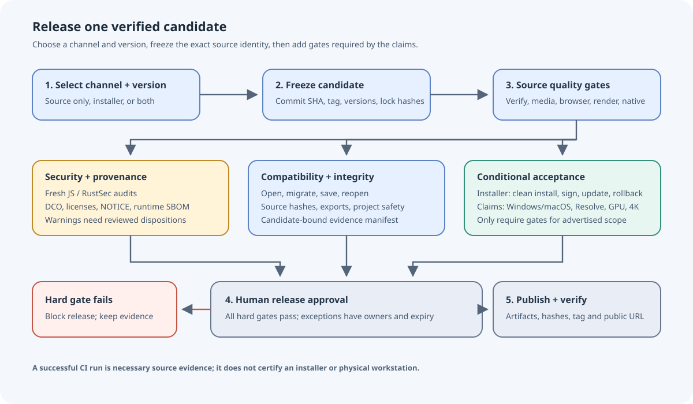
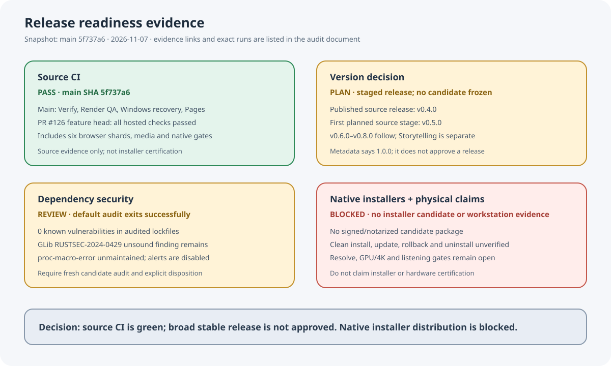

# Stable release gates: current audit

Audit date: 2026-11-07. Evidence base: merged main at
[5f737a6c8f35dce48e213370ff27900962c9304c](https://github.com/bynanci/open-film/commit/5f737a6c8f35dce48e213370ff27900962c9304c).

This is a release-readiness assessment, not release approval. It separates source
releases from installers and from claims that require physical equipment. A green
source CI run does not satisfy those other gates.

## Evidence snapshot

- **Current source.** Main SHA `5f737a6` includes merged PR #126. Verify
  [42317989011](https://github.com/bynanci/open-film/actions/runs/42317989011),
  Render QA
  [42317988938](https://github.com/bynanci/open-film/actions/runs/42317988938),
  Windows media recovery
  [42317988924](https://github.com/bynanci/open-film/actions/runs/42317988924),
  and Pages
  [42317988923](https://github.com/bynanci/open-film/actions/runs/42317988923)
  all completed successfully on that SHA.
  - **Implication:** Strong merged-main evidence; a release candidate still
    needs its own frozen identity and complete checks.
- **PR #126 feature head.** Exact feature head
  [`b4aba4c4bb70b8cb03edd54342f1b94cec649245`](https://github.com/bynanci/open-film/commit/b4aba4c4bb70b8cb03edd54342f1b94cec649245)
  passed hosted checks before merge: fast-contract, heavy-media,
  typescript-and-media, six browser shards, three-platform Render QA, Windows
  FFmpeg9, native-shell, docs-site and DCO. See
  [PR #126](https://github.com/bynanci/open-film/pull/126).
  - **Implication:** These checks apply to the PR feature SHA; they do not
    replace checks on a separately frozen release candidate.
- **Public release.** Latest GitHub release is
  [v0.4.0](https://github.com/bynanci/open-film/releases/tag/v0.4.0), published
  2026-10-20. It includes a source archive, synthetic reference MP4, validation
  JSON and SHA256SUMS; it is not an installer release.
  - **Implication:** Preserve this source-only distinction.
- **Version identity.** Root, Desktop, Tauri and Cargo metadata currently say
  1.0.0, while the latest tag is v0.4.0. The next stable release number has not
  been selected.
  - **Implication:** Choose a release version explicitly and verify all version
    surfaces against the release tag; package metadata alone is not a release
    decision.
- **Rust dependencies.** Security run
  [42297394920](https://github.com/bynanci/open-film/actions/runs/42297394920)
  audited PR #120's dependency set. Cargo lock SHA-256:
  `2e36795c727a50337aa8fe7aa9b20a40bedd99ecf53c265036ae07f13b6c0698`;
  pnpm lock SHA-256:
  `173e22be4859fb74c702aec6fca31e3006b4b9eaeae632fee39f3d87606dc5ba`.
  Both match main. The report found zero vulnerabilities, GLib unsound advisory
  RUSTSEC-2024-0429 and unmaintained proc-macro-error advisory
  RUSTSEC-2024-0370. Tokio 1.53.3 removes RUSTSEC-2026-0386. The scanner treats
  unsound/unmaintained as informational and exits successfully.
  - **Implication:** Scanner success is not a zero-warning security pass.
    Re-audit the frozen candidate against a fresh advisory database and
    disposition the GLib finding for every shipped target.
- **Alerting and enforcement.** GitHub reports Dependabot alerts are disabled.
  The current credential could not read main branch protection settings, so
  required-check enforcement is unknown.
  - **Implication:** Enable Dependabot or equivalent alerting; have a repository
    administrator confirm required checks and release permissions.
- **Native installers.** The native-installer workflow is manual-dispatch and
  input-gated; no candidate run was found. Signing/notarization, clean-machine
  installation, update failure recovery and uninstall preservation remain
  unverified in [M7E validation](validation-native-installer.md).
  - **Implication:** Native installers are blocked. Do not advertise a tested
    installer or signed update path.
- **Physical product claims.** Windows/macOS workstation, Resolve, GPU/4K,
  external-drive and listening observations remain tracked under
  [Issue #7](https://github.com/bynanci/open-film/issues/7).
  - **Implication:** Keep these claims out of release promises until
    candidate-bound observations exist.

## Current decision

There is no selected release candidate or next stable version. The current main
CI is green, but that alone does not authorize a general stable release.

- A scoped source release may be considered after candidate identity, compatibility,
  security and provenance gates below are completed. Any platform or hardware
  limitation that remains must be explicit in the release notes.
- Native installer distribution is blocked until each advertised platform has a
  reviewed runtime and package, trust/signing evidence, and clean-machine install,
  update, rollback and uninstall observations.
- Resolve, GPU, 4K, camera and studio-listening claims require actual evidence on
  the hardware and software named by the claim.

## Proposed release policy

### Gate 1: freeze the release identity

- Select the channel and version deliberately. The next stable version is TBD;
  v1.0.0 remains a roadmap objective, not a presumption.
- Freeze one full source SHA. Record the matching tag, all app/package/Tauri/Cargo
  version fields, project schema/catalog compatibility, and dependency lock hashes.
- Require all release code to be merged, reviewed and present at that exact SHA.
  Record the changelog, supported platform scope and known limitations.
- Never copy a check result from an earlier commit into the candidate record.

### Gate 2: pass source-release checks

- Require the full exact-SHA Verify lanes: format, i18n/docs checks, lint, types,
  contract tests, real media tests, all browser shards, build, interchange, native
  CI, render matrix and Windows recovery where applicable.
- No unresolved P0/P1 correctness or data-loss issue. Failed, cancelled, skipped,
  timed-out or uncollected checks are not passes.
- Exercise project open/save/reopen, supported schema migration, source hashes,
  Undo/Redo and export on synthetic fixtures. Preserve the existing project and
  composition contracts.
- Review license/NOTICE, DCO, source obligations, runtime inventory and SBOM.
  Bind each report to the candidate and lockfile hashes.
- Run JavaScript and RustSec audits on the candidate using a fresh advisory
  database. Known vulnerabilities block release. Unsound advisories require
  remediation or an independently reviewed, target-specific reachability decision
  with an owner, rationale, expiry and recheck trigger. A default scanner exit 0
  cannot silently waive these findings.

### Gate 3: add checks for the distribution

For source-only publication, state clearly that no signed native installer is
included. For each installer platform that is advertised:

- Build from the frozen candidate with reviewed, hash-pinned runtime inputs,
  complete license/source notices and an SBOM.
- Verify the package and runtime hashes. Obtain actual Windows signing or macOS
  signing/notarization receipts where those trust channels are claimed.
- Install as a non-administrator on a clean machine without developer Node,
  FFmpeg, fonts or Perl on PATH. Cover CJK and long paths, first launch, import,
  render, decode, save and reopen.
- Exercise supported update, failed replacement, rollback and uninstall. Verify
  that projects, original media and named versions remain intact.
- Record candidate SHA, package/runtime hashes, OS/build, architecture, tool
  versions, tester, timestamp, result and evidence references.

### Gate 4: bind special claims to real evidence

Physical workstation claims are conditional gates, not generic source CI.
Use the [workstation QA record](workstation-qa.md) and Issue #7 for Windows,
macOS, external volumes, Resolve roundtrip, displays, GPU/4K and audio listening.
If a gate is not run, mark the corresponding claim unsupported or unverified.
Mocks and generated fixtures cannot close hardware or human-quality gates.

### Gate 5: approve and publish

- A release owner reviews the exact candidate, all hard gates, explicit exceptions
  and release notes. Exceptions need a named owner, scope, rationale, expiry and
  next review date; they cannot relabel a failed or not-run gate as passed.
- Publish immutable source/package artifacts with SHA-256 receipts and the
  candidate-bound validation manifest. Keep evidence available beyond short-lived
  CI artifact retention.
- After publication, download the public assets, verify every checksum, confirm
  tag/commit/version agreement and record the final release URL and timestamp.

## Recommended next actions

1. Correct the release-state documents and keep the current next-version decision
   at TBD until the release owner selects it.
2. Enable Dependabot alerts or document the replacement alerting owner and cadence.
3. Confirm main branch protection through repository administration and require
   the exact source, render, Windows and provenance checks that match the release scope.
4. Re-run both dependency audits on the eventual candidate with a fresh advisory
   database. Keep GLib RUSTSEC-2024-0429 open until remediation or independent
   source-aware disposition is complete; keep the unmaintained notice visible.
5. Keep M7E blocked until actual per-platform installer artifacts and workstation
   evidence exist. Do not make a v1.0.0 or installer promise from metadata alone.

## Sources

- [Current development tasks](https://github.com/bynanci/open-film/blob/main/TASKS.md) and [roadmap](https://github.com/bynanci/open-film/blob/main/ROADMAP.md).
- [Native installer validation](validation-native-installer.md) and
  [workstation checklist](workstation-qa.md).
- [Historical v0.4.0 validation](validation-stable-release.md).
- [PR #120 Tokio remediation](https://github.com/bynanci/open-film/pull/120) and
  [PR #126 deterministic visual keyframes](https://github.com/bynanci/open-film/pull/126).
