# Silence Review UI validation

## Scope

Silence Review is part of the existing Precision editor. It reads the active
Composition and asset list from `TimelineEditor`; it does not keep a second
Composition or Timeline. Analysis, Review creation, cancellation, retry,
recovery and Apply use the durable Silence application and HTTP APIs.

## Data flow

```mermaid
flowchart LR
  P[Precision workspace] -->|POST /silence/jobs: source, options, revision| J[Durable silence Job]
  J --> S[Existing SilenceService]
  S -->|measured source evidence + timeline mappings| R[Immutable Review]
  R -->|candidate source/time and timeline positions| W[Existing source waveform]
  W -->|keep or exclude staged locally| D[POST /review: child Job]
  D -->|derive from saved evidence; no re-decode| R2[New immutable Review]
  R2 -->|POST /apply: exact reviewId + proposal| A[Silence application API]
  A -->|existing ripple command and history| T[TimelineEditor]
  T -->|reload authoritative editor state| P
```

The Job binds project, asset, Composition revision, source hash, analysis
settings and owner. Candidate selection changes only staged UI state. Saving a
selection creates an idempotent child Job with the parent Job, source Review and
selected candidate IDs; the server derives and persists a separate immutable
Review from the parent’s saved evidence. It never edits the saved proposal in
place or analyzes the source a second time.

Apply submits the exact selected Review and proposal to the application API.
The application revalidates source hash, Composition revision, review content,
locks, user pins, audio timing and existing audio automation before issuing the
existing ripple edit. The editor reloads the returned authoritative
Composition, so existing autosave and Undo/Redo remain the source of truth.
Repeated Apply requests retain the same request ID; source/revision conflicts
are shown in the panel and do not change the Composition.

## UI behavior

- Select an audio/video asset used on a primary timeline track. Threshold,
  minimum silence and edge padding are validated before Analyze is enabled.
- Job status shows queued, running, waiting for review, failed, cancelled,
  another process, stale and applied states. Reconnect refreshes the durable Job;
  cancellation and stopped-owner recovery use `AnalysisJobActions`.
- Review rows show the measured source interval and each matching timeline
  interval. Candidate overlays use the existing Precision waveform and retain
  selected/excluded states. Preview seeks the existing source player and stops
  at the candidate boundary.
- Keep/exclude actions are staged until “Create updated Review” succeeds. The
  new Review is a durable child Job; the parent Review remains byte-for-byte
  unchanged.
- The confirmation summary shows the selected candidate count, estimated
  removal duration, source and affected clips. Accept calls the application API;
  no Vue clip array is modified.
- Source or Composition changes invalidate Apply. Project/context switches
  abort UI requests, clear transient candidate state and discover Jobs bound to
  the new context. A pending source preview is discarded on project or
  Composition changes.

## Screenshots

Screenshots use a synthetic 4-second WAV source only. They are full-page browser
captures taken with the named viewport sizes (the document height includes the
editor and workspace chrome):

- [Silence Review at 1024 × 768](/screenshots/silence-review-1024x768.png)
- [Silence Review at 1920 × 1080](/screenshots/silence-review-1920x1080.png)

At 1024 × 768, the existing Precision monitor and inspector remain side by
side so the Inspector tabs stay in the editing viewport. Container-aware rules
stack settings and wrap candidate timecodes inside the narrow inspector. At
900 pixels and below, the workspace stacks the monitor, waveform and panel.
The 1920 × 1080 layout keeps the Review panel beside the source monitor.

## Automated evidence

| Command                                                                                                                                                                    | Result                                                                                                                                                                                                               |
| -------------------------------------------------------------------------------------------------------------------------------------------------------------------------- | -------------------------------------------------------------------------------------------------------------------------------------------------------------------------------------------------------------------- |
| `pnpm format:check`                                                                                                                                                        | Passed.                                                                                                                                                                                                              |
| `pnpm lint`                                                                                                                                                                | Passed.                                                                                                                                                                                                              |
| `pnpm typecheck`                                                                                                                                                           | Passed.                                                                                                                                                                                                              |
| `pnpm build`                                                                                                                                                               | Passed; Vite reports the existing large-chunk advisory.                                                                                                                                                              |
| `pnpm test:i18n`                                                                                                                                                           | Passed; 3,089 semantic keys match across English, Traditional Chinese and Japanese.                                                                                                                                  |
| `pnpm test:docs-i18n`                                                                                                                                                      | Passed; 154 English documentation mirrors match.                                                                                                                                                                     |
| Focused core/application/HTTP Vitest suites                                                                                                                                | Passed; 5 files, 76 tests.                                                                                                                                                                                           |
| `packages/catalog/tests/analysis-ownership.test.ts`                                                                                                                        | Passed; 44 tests, including strict source/revision request identity.                                                                                                                                                 |
| `pnpm exec playwright test tests/e2e/silence-review.spec.ts`                                                                                                               | Passed; 3 browser tests. Covers Analyze → Review → Accept → Undo → Redo → Save → Reopen, keyboard selection, modal focus/Escape, reduced motion, both viewport sizes, stale source, HTTP 409 and zh-TW/ja-JP labels. |
| `pnpm exec playwright test tests/e2e/precision-editing.spec.ts --grep "uses real source analysis, a disclosed protocol transcript, snapped trim and shared split history"` | Passed; 1 regression test confirms the Precision tabs remain in the viewport at all supported desktop sizes, including 1024 × 768.                                                                                   |
| `pnpm exec playwright test tests/e2e/precision-editing.spec.ts --grep "precision smoke keeps source analysis and navigation localized at desktop sizes"`                   | Passed; Traditional Chinese and Japanese smoke tests at desktop sizes.                                                                                                                                               |
| `pnpm test:browser-partition`                                                                                                                                              | Passed; 332 browser cases partitioned across four shards (83 / 86 / 80 / 83).                                                                                                                                        |
| `npm --prefix docs run build`                                                                                                                                              | Passed; VitePress documentation site builds.                                                                                                                                                                         |
| `OPENFILM_OTIO_PYTHON=/tmp/openfilm-otio-venv/bin/python pnpm test`                                                                                                        | Passed; 442 files and 5,814 tests. The repository's pinned OpenTimelineIO virtual environment was used for NLE handoff coverage.                                                                                     |

The end-to-end fixture creates a deterministic WAV with two silent intervals,
imports no personal material and uses the real server, SQLite catalog,
SilenceService and TimelineEditor. The acceptance test verifies the exact
Composition duration against the saved Review proposal, undoes and redoes the
edit, then closes and reopens the project and verifies the durable Job and
Composition.

## Known limits

- Silence detection measures audio level; it does not infer whether a pause is
  meaningful speech. The panel states this beside the settings.
- Preview is source playback. It does not generate a rendered before/after
  audition or crossfade.
- A measured candidate without a matching primary-timeline interval can be
  inspected but cannot be applied as a timeline edit.
- Full Windows/macOS workstation, native packaging and device-specific media
  QA are outside this UI change.
