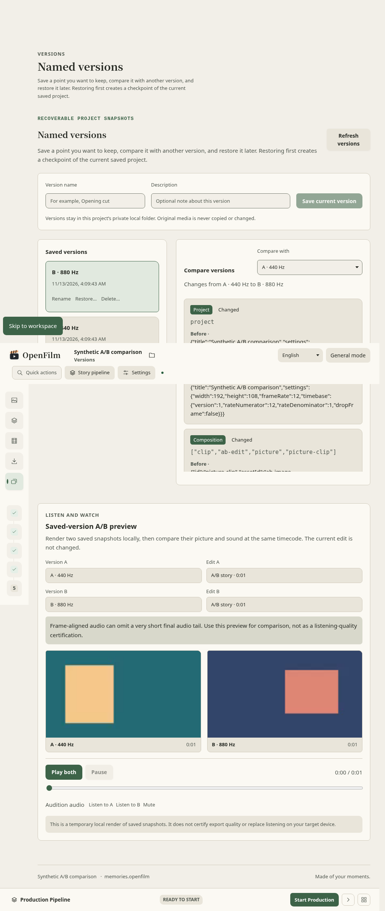
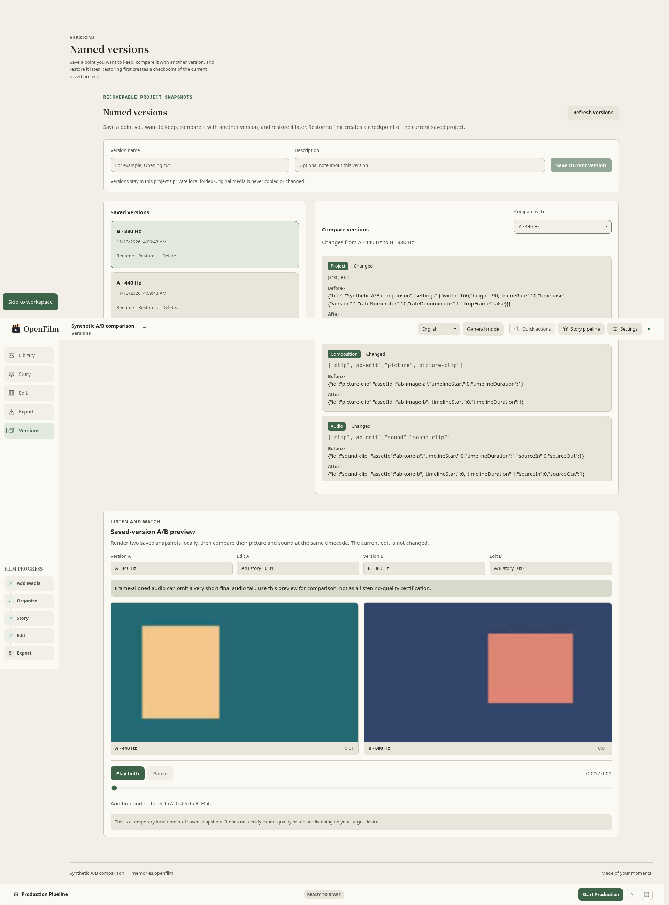

# Named-version A/V comparison validation

Date: 2026-11-13. Candidate base: `befe2e5b86db17c643cfc4d7bdc93bd40fee1f1a`
(`main` at implementation start). This change adds an explicit, read-only
picture-and-sound preview for two saved Named Versions. It does not restore,
adopt, or edit the current Composition, and it does not replace Creative
Variants' comparison workflow.

## Data flow and safety

The existing Named Version service loads and verifies each immutable saved
project/catalog snapshot, its selected Composition, asset records, source
hashes, render settings and font settings. The existing FFmpeg Renderer renders
the two saved cuts sequentially. A single owned render Job records progress and
the existing export-request lock fences competing processes. Only after both
outputs pass stream-shape, frame-count, source-manifest, file-identity and
SHA-256 checks is the pair published to the existing project-private cache.
HTTP exposes an opaque pair ID and guarded MP4 byte ranges; it never returns
filesystem paths or source URIs. Exact request IDs are validated before a Job
is reserved. Cancellation returns after the owned render and cleanup drain.

The Desktop Versions panel holds only version/composition IDs, the opaque
descriptor and shared playback state. One time control seeks both native video
elements; only the selected side can be audible. Navigating away, switching the
project or closing the panel pauses, unloads and revokes the owned preview. It
does not copy or mutate Composition/clip arrays. The cache is private,
permission-restricted, limited to one hour per Composition, 1 GiB per MP4,
2 GiB total and 15 minutes; prepared media is ephemeral across server restarts.

## Local verification

Synthetic fixtures use red/blue stills and 440/880 Hz WAV tones. The application
test creates two immutable versions with different dimensions and frame rates,
then decodes frames 0, 5 and 9 from each actual MP4. It checks the expected
color channel thresholds, selected-tone amplitude at least 20 times the
opposite tone, H.264 stream dimensions/rate/frame count, AAC presence and
duration. It verifies source hashes and immutable version payload hashes before
and after rendering, and confirms the active manifest, semantic Catalog state,
Composition and Undo state are unchanged. The HTTP test checks output hashes,
private cache headers, valid/invalid byte ranges, wrong-project rejection,
foreign-owner cancellation rejection, invalid request IDs, and live cancel
draining. No private media or provider is used.

The browser regression loads the real prepared MP4s in Chromium, checks
metadata decode, synchronized playback/seek, audible-side switching, navigation
cleanup and project close/reopen while saved versions remain. It checks for
horizontal overflow at 1024×768 and 1920×1080 and attaches a synthetic UI
screenshot at each size to the Playwright result.

### Synthetic UI screenshots

These screenshots come from the synthetic A/B project used by Playwright; they
contain no personal media.

Local toolchain: Node `v24.19.0`, pnpm `11.19.0`, FFmpeg `7.1.5-0+deb13u1`,
Chromium `151.0.7922.173` on Debian 13.

Focused A/V Vitest checks passed `47` tests across four files, including the
actual FFmpeg application render and real HTTP integration scenario. The App
navigation extraction suite passed another `38` tests. The combined Playwright
run passed `12` tests across `editor-mount-lifecycle.spec.ts` and
`project-versions.spec.ts`; this includes the project-switch case that first
failed on exact head `d17bbb6` due a duplicate initial editor read. The fix
reloads only an editor instance that was already mounted before the awaited
workspace transition. `pnpm test:i18n`, `pnpm test:docs-i18n`, and Prettier on
workspace transition. An initial, incomplete full-suite attempt without
`OPENFILM_OTIO_PYTHON` surfaced an NLE handoff failure because it selected
system `python3`, which did not have OpenTimelineIO installed. With the CI-pinned
OpenTimelineIO `0.18.1` in an isolated Python 3.12 environment, the NLE case
passed and the complete `pnpm test` passed all `6,313` tests across `477` files
in `1,471.12` seconds. `tests/integration/native-runtime.test.ts` also passed
all `52` tests in `154.98` seconds, including the case that timed out in an
earlier interrupted run.

Exact head `30b9bde59216300a66647ed32e18cbf058db4b5c` passed
`fast-contract-check` and all six browser shards, but docs-site failed because
the English mirror referenced screenshots present only under `docs/images`;
heavy-media was cancelled when the branch advanced. Both synthetic screenshots
are now mirrored under `docs/en/images`, and the VitePress build passed locally.
Exact head `12a382a7f44b2e233491ca693d4d506691cf8167` passed every GitHub check:
DCO, fast-contract, all six browser shards, heavy-media, native-shell, Windows
recovery, Linux/Windows/macOS Render QA, docs-site and the Verify aggregate.
The documentation-only update that records these results requires its own
exact-head CI run.

## Limits and separate gates

- This validates decoded synthetic playback and channel selection. It is not a
  human listening-quality, device-latency, hardware, or production-export
  certification. The preview discloses that frame-aligned output can omit a
  short final audio tail; it does not quantify or audition that tail.
- The known 1,152-sample / approximately 24 ms mixed-export audio-tail case and
  Export workspace warning remain a separate follow-up; see
  [real-media silence validation](validation-silence-real-media.md).
- This covers Named Versions. It does not replace the Creative Variants modal
  or migrate its existing placeholder A/V comparison.
- Restart discards ephemeral preview outputs; durable Named Version snapshots
  remain intact and can be rendered again with a new request ID.
- Windows/macOS installers, signing/notarization, clean-machine update/rollback,
  native workstation checks, Resolve interchange, external media, GPU/4K and
  release-owner approval remain separate gates in
  [release validation](validation-release-gates.md).

## Test record

| Check                                                                          | Result                                                                                                                                  |
| ------------------------------------------------------------------------------ | --------------------------------------------------------------------------------------------------------------------------------------- |
| Focused A/V application, HTTP, UI and playback Vitest (4 files)                | Passed, 47 tests; includes real HTTP and FFmpeg output                                                                                  |
| App navigation extraction Vitest                                               | Passed, 38 tests                                                                                                                        |
| Playwright Editor lifecycle + Named Versions                                   | Passed, 12 scenarios; screenshot attachments at 1024×768 and 1920×1080                                                                  |
| `pnpm test:i18n`, `pnpm test:docs-i18n`                                        | Passed; 3,288 semantic keys, 195 English mirrors                                                                                        |
| `pnpm format:check`                                                            | Passed in exact-head `fast-contract-check` for `12a382a7`                                                                               |
| `OPENFILM_OTIO_PYTHON=/tmp/openfilm-version-av-otio-venv/bin/python pnpm test` | Passed, 477 files and 6,313 tests in 1,471.12 s; OTIO 0.18.1 selected explicitly                                                        |
| `tests/integration/native-runtime.test.ts`                                     | Passed, 52 tests in 154.98 s, including the previously timed-out case                                                                   |
| `pnpm lint`, `typecheck`, `test:contracts`                                     | Passed in exact-head `fast-contract-check` for `12a382a7`                                                                               |
| Build, heavy-media, Windows recovery, three-platform Render QA, docs-site      | Passed in exact-head CI for `12a382a7`                                                                                                  |
| Browser shards                                                                 | 5/6 passed on `d17bbb6`; shard 1 duplicate-read regression fixed locally                                                                |
| Exact-head `30b9bde5` Verify                                                   | fast-contract and 6/6 browser shards passed; docs-site failed on missing English screenshots; heavy-media was cancelled when superseded |
| Exact-head `12a382a7` CI                                                       | Passed all checks: DCO, fast-contract, 6/6 E2E, heavy-media, native-shell, Windows recovery, 3-platform Render QA, docs-site, aggregate |
| Exact-head CI for this documentation update                                    | Pending                                                                                                                                 |
