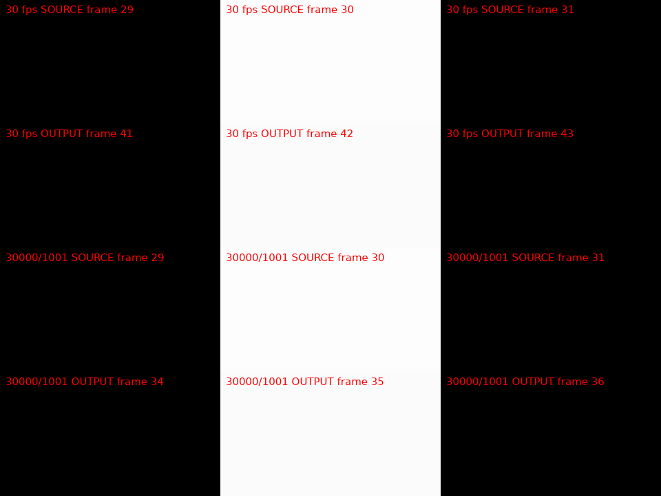

# Acoustic boundary and audio/video sync validation

Date: 2026-11-17 (Asia/Taipei). Base: `55ee98655cef3f5c5a0f8a4788953a13d14021ca`.
The implementation started in `6c8c430b894b72fa22bdfef3af71002d352655de`.
This record covers synthetic source behavior in the Linux Cloud environment;
final source SHA and hosted checks are recorded on the implementation PR.

本輪補齊合成瞬態、底噪、配樂尾音與音畫同步驗證，並修正實際重現的
limiter 延遲／尾端 sample 遺失。所有素材均為程序生成；Resolve 實際匯入、
Windows/macOS 裝置、主觀聽感與原生安裝驗收仍保持未完成。

## Reproduced output defect and repair

The common output filter used `alimiter=limit=0.95` before padding and a fixed
Composition-duration trim. FFmpeg's default five-millisecond lookahead delayed
the stereo 48 kHz output by 239 samples. A source with impulses at
`[0, 67200, 191999]` rendered as `[239, 67439]`: the final impulse was lost.
Both the actual full-mix and dialogue-stem Renderer regressions failed on those
independent expected positions before the production fix.

The common filter now uses `alimiter=limit=0.95:latency=1`. Compensation flushes
the buffered audio before the final trim, retaining all three original sample
positions in both channels. Limiter gain, limiting, auto-level and duration
policies are preserved. No project schema, editing command, source file,
Review/Accept, lock/User Pin, or history contract changes.

The two new timing tests compare to source positions rather than measuring a
shared rendered baseline. Three existing independent FFmpeg reference graphs
also use the compensated limiter; their PCM precision assertions remain intact.
Independent static review found no blocking production finding.

Existing exported files and retained previews keep their original bytes. Prepare
a fresh preview or use a new export request ID to obtain the corrected render.
This repair does not accept or remove the separate 1,152-sample / 24 ms
frame-aligned export-tail warning in Issue #144.

## Acoustic cases

`transientSilenceAuditionFixture` generates five seconds of seeded, nonzero room
floor, a bounded breath envelope, damped transients and independent decaying
220/330 Hz music tails. Source rates are 44,100 and 48,000 Hz. This fixture is a
low-energy detector and editing-contract test, not a speech/VAD model.

The detector runs on 48 kHz channel-maximum samples in 20 ms windows, with
−40 dBFS threshold, 0.5-second minimum silence and 0.1-second padding.

| Expected observation            | Independent result                                    |
| ------------------------------- | ----------------------------------------------------- |
| Detected source intervals       | `[0.5, 1.3)`, `[3.0, 3.6)` seconds                    |
| Padded source/timeline cuts     | `[0.6, 1.2)`, `[3.1, 3.5)` seconds                    |
| Short pauses                    | 0.4- and 0.3-second spans remain                      |
| Right-channel-only event        | `[3.6, 3.7)` prevents a continuous one-second silence |
| Removed source samples          | 44,100 / 48,000 at the respective source rates        |
| Rendered samples before / after | 240,000 / 192,000, stereo 48 kHz                      |
| Removed output samples          | 48,000                                                |

The tests verify immutable analysis/Review state, padded cut positions, music's
own overlay clock, literal retained dialogue source/record ranges and the
right-only event's energy at output 2.6–2.7 seconds, explicit Accept,
duplicate-apply receipt, Undo/Redo, unchanged source hashes, exact accepted
Record PCM parity and independent WAV precision of
at most two signed-24-bit LSBs. Initial observations had zero PCM error at both
source rates. Synthetic measurements leave perceptual quality unverified.

## Independent decoded sync cases

Two additional cases extend the existing interchange fixture set; they use the
same Composition, shared timebase, OTIO exporter and FFmpeg Renderer. Each source
contains 120 frames at 160×90, one white source frame at frame 30, and a matching
50 ms, 1 kHz stereo PCM marker. Audio source/record handles use canonical absolute
sample positions.

| Case              | Rate       | Source marker sample | Trim / placement frames | Output flash frame | Output PCM marker sample |
| ----------------- | ---------- | -------------------: | ----------------------- | -----------------: | -----------------------: |
| `sync-30`         | 30/1       |               48,000 | 12 / 24                 |                 42 |                   67,200 |
| `sync-fractional` | 30000/1001 |               48,048 | 10 / 15                 |                 35 |                   56,056 |

The Python oracle pins literal trim, placement, source handles and marker clocks
independently of generated metadata. It reads/writes/reads official OTIO and
completely decodes both source and output video/PCM. Frame and PCM timing
uncertainty is zero. Absolute rational sample endpoints avoid rounding each
30000/1001 frame to an integer number of samples.

FFprobe also verifies every one of the 120 presentation timestamps per video
against the exact rational frame grid, zero stream starts and declared video
durations. The observed video timebases are `1/15360` and `1/30000`, with
duration ticks 61,440 and 120,120. AAC stream presentation starts at sample 0
and ends at 192,000 / 192,192 samples; decoder padding is measured separately.



This contact sheet contains actual decoded synthetic frames from the retained
MP4s, with frame labels applied after decoding. Its four rows show source/output
at 30 fps and source/output at 30000/1001 fps. It is not a Resolve UI screenshot.

MP4 AAC is decoded and measured separately from exact full-mix PCM. The declared
AAC onset/end allowance is one AAC-LC transform frame (1,024 samples) at the
0.01-amplitude threshold, accounting for lossy pre-echo/ringing. Observed marker
onsets were 67,197 / 56,053, three samples before the exact PCM markers; ends
were three samples later. Decoded AAC lengths were 192,512 for both files,
compared with exact WAV lengths 192,000 / 192,192. The codec allowance never
applies to PCM/video and does not approve listener-perceived sync or device
latency.

The original cut/edited/fractional cases, FCPXML resources, source-hash/bounds,
missing-source rejection and relocated-bundle checks remain. Both new fixture
names can be selected by the existing Resolve QA CLI. Its unit tests retain
source-tamper and unknown-fixture rejection and keep generated manual records at
`not-run` / `realNleVerified: false`.

One initial interchange run failed strict full-Composition equality because
OpenTimelineIO serialized the fractional fixture's floating duration
`4.0040000000000004` as `4.004`. The fixture now declares duration through its
integral 192,192-sample endpoint and checks shared frame-duration equivalence.
The original metadata-equality assertion was preserved; no tolerance was added.

## Three-platform limiter gate

The existing finishing lane now selects six files, adding the absolute limiter
regression to the five existing rendering files. Both full-mix and dialogue-stem
cases must pass with exact first/interior/final stereo sample positions on
Ubuntu, Windows and macOS; there is no AAC or pixel allowance on these PCM
checks. The shared aggregate rejects an otherwise internally consistent old
five-file report and any failed limiter assertion. Local selection/accounting
controls passed 4 files / 88 tests. The combined acquisition/accounting/limiter
selection subsequently passed 9 files / 201 tests. Actual local Render QA passed
1/1 and the full six-file finishing selection passed 21/21 with fixed font
hashes and FFmpeg 7.1.5. Their receipts explicitly record a dirty local checkout
and `workstationVerified: false`; hosted results belong to the final PR head.
The first font acquisition could not connect directly; the existing configured
proxy admitted the unchanged pinned bytes with `NODE_USE_ENV_PROXY=1`.

## Cloud tools and Resolve boundary

The verified toolchain is Node 24.19.0, pnpm 11.11.0, Python 3.12.14,
FFmpeg/FFprobe 7.1.5 and official OpenTimelineIO 0.18.1. Chromium 151 and Noto CJK
fonts are available. The user-owned environment setup installs the pinned pnpm
and OTIO interpreter, uses the frozen lockfile and builds the application.

Resolve is absent, and the existing API probe exits 2 (`blocked`). The Cloud
machine has no GPU render device or OpenCL platform (`CL_PLATFORM_NOT_FOUND_KHR`,
zero platforms). Shared desktop capability is available on demand; starting a
display does not supply that GPU. No registration, Resolve download, installer
license acceptance or Resolve process was performed.

The official [Linux release metadata](https://www.blackmagicdesign.com/api/support/latest-stable-version/davinci-resolve/linux)
was reachable and reported Resolve 21.2 build 6. Its official
[README](https://www.blackmagicdesign.com/support/content/readme/801a108506a54a908ffcd497f13b60de)
requires a supported Linux environment, a discrete GPU with at least 4 GiB VRAM
and OpenCL/CUDA. The official free Linux download requires registration with real
contact details. The retained local prerequisite receipt records actual responses
and hashes. These facts do not establish an installable or runnable Resolve on
this Debian CPU-only Cloud host.

## Validation and reproduction

Focused checks completed before the full suite (with retained-dialogue assertions
subsequently passing the same 13-case audition file):

| Check                                         | Result                                                                   |
| --------------------------------------------- | ------------------------------------------------------------------------ |
| New absolute limiter timing                   | 2/2; observed RED then GREEN                                             |
| Existing audio-policy suite                   | 21/21                                                                    |
| Source activity and audition cancellation     | 12/12                                                                    |
| Silence audition media                        | 13/13, including both new transient rates                                |
| Official interchange and portable preparation | 21 Python tests; 5 OTIO cases; 8 source assets; 2 decoded sync cases     |
| Contract suite                                | 82 files / 1,582 tests                                                   |
| Test partition                                | 481 = 82 contract + 399 media files                                      |
| ESLint and TypeScript/Vue                     | Passed                                                                   |
| Build                                         | Passed; existing large TimelineEditor chunk warning remains              |
| Browser Silence / Record workflows            | 7/7, exit 0; trace and 1024×768 / 1920×1080 UI captures retained locally |

The root `pnpm test` at implementation `6c8c430b` reported **481 files / 6,346
tests passed** in 1,164.01 seconds. Its enclosing strict login-shell wrapper
returned 1 without persisting the inner pnpm exit code. Minimal independent
controls traced this to `/home/agent/.bash_logout`: `clear_console -q` fails
without a TTY and overrides even explicit `exit 0` under `set -e`. An 18-test
control explicitly recorded pnpm status 0 while that wrapper still returned 1;
non-login and natural-end controls returned 0. The original inner status cannot
be reconstructed from passed assertions alone, so the original command is not
claimed as an exit-0 gate. Subsequent status-sensitive commands use non-login
execution; the user's shell profile is unchanged. This is Cloud shell behavior,
not a change to Vitest assertions or hosted CI.

```sh
pnpm install --frozen-lockfile
pnpm test:media packages/render/tests/audio-limiter-timing.test.ts tests/integration/silence-audition-media.test.ts
pnpm test:interchange --output /absolute/new-empty-synthetic-evidence
python3 scripts/resolve-qa/resolve_qa.py probe
```

The final probe is expected to report `blocked` on this Cloud machine. Do not
count that result as a passed Resolve integration. Full-suite, browser and hosted
check results belong to the corresponding implementation PR/source revision.
Issues #7 and #140–#146 retain their independent runtime, native lifecycle,
workstation, listening, performance and administrator gates.

## Source CI and portable handoff follow-up

Implementation head `5981a5c7a8cdc322f93a40d5992acf5f47472bf0` passed the
complete [Verify run 44077512542](https://github.com/bynanci/open-film/actions/runs/44077512542):
82 contract files / 1,582 tests, 399 media files / 4,771 tests, all 366 browser
cases across six shards, build, interchange, native-shell and docs. This is
exit-0 hosted evidence for that exact source, separate from the older local
login-shell wrapper outcome. Windows recovery and Linux/Windows Render QA also
passed; macOS stopped at installed dependency identity observation before its
media suite. The final PR head still needs its own complete gates.

The portable reference folder now retains exact repository `LICENSE` and
`NOTICE` bytes for its copied QA scripts/documentation; both are included in
the existing file-hash inventory. Generated media remain procedural CC0.
The actual generator/official-parser/relocation gate passed after this addition,
and independent comparison verified both texts and inventory hashes against
the repository. This supplies no runtime binary redistribution approval.

Diagnostic commit `08aa5bb9bb78f0c47f13b160b772889721f2aa4b` preserves the
dependency admission guards and records only bounded rejected fields, names,
installed counts/versions, linked-keg identity and observation hash/size. Its
[first diagnostic dispatch](https://github.com/bynanci/open-film/actions/runs/44079308355)
passed Linux and Windows but GitHub abandoned the unassigned macOS job with
`The job was not acquired by Runner of type hosted even after multiple attempts`
and an ARM64 capacity notice. No macOS dependency cause was observed in that
attempt. A complete second attempt uses the same diagnostic SHA; its result
remains separate from a final candidate's required three-platform evidence.

The macOS dependency diagnostics subsequently observed two coinstalled-keg
failures (`p11-kit` and `harfbuzz`). The bounded active opt/Cellar filesystem
proof and its positive/negative regressions are documented in the
[Render QA admission record](../validation-render-qa.md). This correction
retains strict source/tool/font/output gates; the eventual candidate needs its
own complete hosted matrix.
