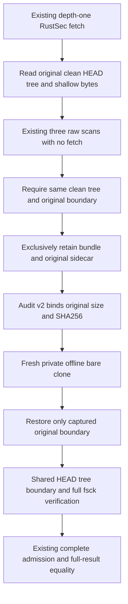

# Faithful advisory database snapshots — 2026-11-12

This bounded change addresses original RustSec database serialization within
[issue #140](https://github.com/bynanci/open-film/issues/140). It does not accept a
native installer, grant redistribution rights, approve a maintenance exception
or certify a workstation.

## Identities and scope

The isolated branch starts at main
`81714e287a76aac1e46b6bea7e1806a408aa9a63`. Its integrated implementation is
`8d713c8c7876f217856786063de683808d4a62f4`. The task report binds all six authority
files to actual Git blobs and SHA-256 digests; tool/subject equality remains
mandatory. No dependency, scanner, compiler, timeout or byte limit changes.

The historical A151/v1 replay remains the unchanged observation described in
[the source replay record](issue-followup-2026-11-12.md). Its full-fsck missing
parent and expired original freshness are not relabeled as a v2 success.

## State flow

New audit schema2 requires `dbSnapshot.format: git-shallow-bundle-v1`, exact
nested keys/types, the captured HEAD root tree, and fixed ordinary bundle and
sidecar leaves. `advisory-db.shallow` is the original 41-byte single SHA-1 HEAD
plus LF, read before scans. Unknown, malformed, stripped or downgraded captures
fail; no boundary is inferred, normalized or fetched.

The existing auditor supplies shared capture, restoration and verification for
the original CLI, Python replay and TS bridge. All original 16 payload roles
remain; the new sidecar makes **17 payload roles**, or **18 pins** including
admission in the minimal TS observation. The replay envelope and admission result
remain schema1. The existing six-authority equality, whole-result comparison,
original absolute source path, source/lock/graph checks and six-hour freshness
still apply. Historical v1 bytes remain tied to historical policy tools.

Git isolation removes caller overrides, disables global/system config, hooks,
replacements, lazy fetch and optional index writes, and rejects external object
stores or unsupported repository config. Restoration writes only to a fresh
private clone. Ordinary `git --no-replace-objects fsck --full --no-reflogs` must
succeed: the exact captured shallow parent boundary is valid; missing current
trees/blobs fail. Exclusive output creation preserves any raced existing bundle
sentinel. Original database index bytes remain unchanged during verification.

## Observed development verification

| Check                                            | Actual result                                                                                                 |
| ------------------------------------------------ | ------------------------------------------------------------------------------------------------------------- |
| First behavior RED                               | Real depth-one clone retained no sidecar; existing retainer test failed before production edits               |
| Original-role uniqueness RED                     | A duplicate scanner role with a different digest was accepted; final TS guard rejects it                      |
| Exclusive-output RED / GREEN                     | Deterministic destination race failed first, then passed with exclusive ordinary-file creation                |
| Read-only RED / GREEN                            | Mtime-only advisory change exposed Git index refresh; optional-lock prevention preserves original index bytes |
| Final producer/helper suite                      | 17 Python tests passed at exact implementation head                                                           |
| Final admission suite                            | 33 Python tests passed at exact implementation head                                                           |
| Final standalone replay suite                    | 20 Python tests passed at exact implementation head                                                           |
| Final real TS/Python bridge and candidate suite  | 42 tests / 2 files passed at exact implementation head                                                        |
| TypeScript/Vue, changed-file ESLint and Prettier | Passed; TS bytes unchanged by the final two Python-only fixes                                                 |

Regressions include visible-only transport after upstream/original deletion,
strict versions/types/fields, re-pinned malformed boundaries, missing tree/blob
objects with valid HEAD/boundary, worktree drift, hostile Git environment/config,
linked or occupied paths, duplicate roles, full-result/float-byte preservation,
original-path diagnostics, and stale/future/expiry-during-validation rejection.
The initial standalone diagnostic test expected an unsanitized error; production
correctly returned the existing safe typed rejection. The assertion now checks
that exact safe contract, and the final full suite passes. No source test is
skipped or weakened; selected RED cases are distinct from final full-suite runs.

The local host uses Node24.19.0/pnpm11.19.0 versus unchanged hosted
24.14.0/11.11.0 pins. No local cargo/rustc/rustup is available. Synthetic scanner
and Git fixtures establish protocol behavior, not a current RustSec observation
or actual native build. Whole-repository and exact-head hosted results are
tracked separately in the development PR.

## Remaining external evidence

A new candidate containing these policy bytes needs its own real source capture,
original ZIP authentication and complete original-path replay before the original
six-hour deadline. A base81714 or historical A151 capture cannot admit changed
policy. The prior actual v1 replay remains historical evidence only.

Issue #140 remains open for same-candidate final native receipts, signed final
bytes, target post-build scans/observations and independent acceptance. Runtime
source/license/SBOM/rights closure, Windows/macOS trust/lifecycle, listening and
hardware performance retain their separate gates. No source Release, tag,
signing credential or repository setting is changed by this patch.
