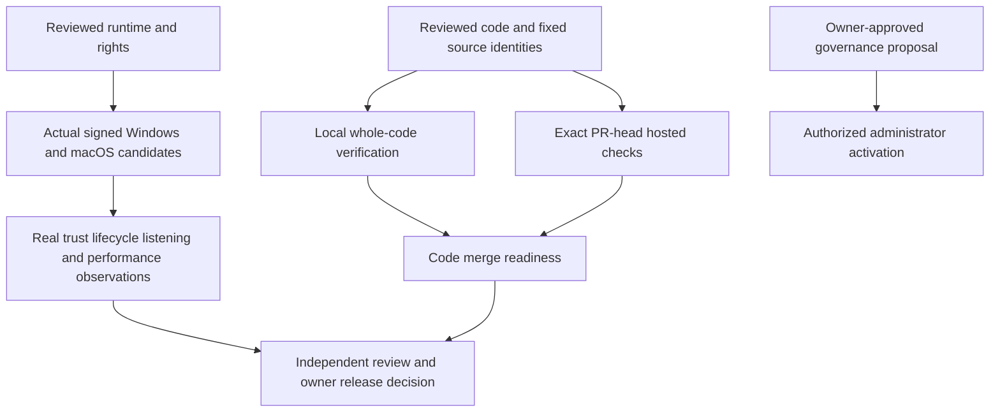

# Issue execution evidence — 2026-11-11

This record separates implemented code, observed verification and outstanding
owner/platform acceptance. It does not approve an installer or release. The
latest published source release remains v0.4.0; the exact source/asset decision
for historical [PR #129](https://github.com/bynanci/open-film/pull/129) remains separate.

## Source and delivery identities

| Scope                                  | Exact identity / record                                                                                                                                                  |
| -------------------------------------- | ------------------------------------------------------------------------------------------------------------------------------------------------------------------------ |
| Original implementation baseline       | `08e38b6a63a0b0fbcfd3a073c8bfa5dcc8c08224`                                                                                                                               |
| Issue plan                             | [PR #147](https://github.com/bynanci/open-film/pull/147), merged as `dd3af6ce38d7577cc4aec5e184b76fc14f459d6d`                                                           |
| CI/source guards and measured profiler | [PR #148](https://github.com/bynanci/open-film/pull/148), tested source `d008d01abfc8cf402fb3ed0d8fcbdf7acec6a9c3`, merged as `338b3c4a5fbee3627bc0b75df3e77277230d04bc` |
| Read-only SDK capsule                  | [PR #149](https://github.com/bynanci/open-film/pull/149), reviewed delivery `4d68d526cc0139bb8b857334d0d70c33959c037b`                                                   |
| Native receipt/runtime intake          | [PR #150](https://github.com/bynanci/open-film/pull/150), reviewed delivery `5dacfed92cf1b350486162b736f2d559b67355ad`                                                   |
| Final integrated delivery              | [PR #151](https://github.com/bynanci/open-film/pull/151); its current head, checks and merge status are the live final-head record                                       |
| Local whole-code verification          | Private integration commit `b8bb14ba64eb66d4719dc97fc77216cbebd6e365`; all non-documentation file blobs match the final integrated delivery                              |

PR #151 includes the reviewed SDK/native branches so its checks can exercise the
whole code set. Merge #149 and #150 first; their shared changes then leave its
diff. A passing local integration run is not a passing future PR-head CI run.
The document uses the live PR record rather than embedding its own commit hash.

## Observed local verification

The final private integration commit passed `pnpm test`: **465 files / 6,114
tests**, exit 0, **613.60 s**. The earlier pre-fix integration passed 6,109 tests;
that historical result is not substituted for the final run. The 1,548 contract
tests below are a subset, not an additional full-suite total.

All 20 commands below exited 0 against that same final integration commit:

| #   | Command                                                                                     | Evidence scope                                    |
| --- | ------------------------------------------------------------------------------------------- | ------------------------------------------------- |
| 1   | `pnpm format:check`                                                                         | Complete checkout formatting                      |
| 2   | `pnpm test:i18n`                                                                            | Existing UI locale contracts                      |
| 3   | `pnpm test:docs-i18n`                                                                       | README locales and byte-identical English mirrors |
| 4   | `pnpm test:license`                                                                         | Existing Apache-2.0/NOTICE governance             |
| 5   | `pnpm test:provenance`                                                                      | DCO policy regressions                            |
| 6   | `pnpm lint`                                                                                 | Complete checkout lint                            |
| 7   | `pnpm typecheck`                                                                            | TypeScript and desktop Vue types                  |
| 8   | `pnpm test:ci-partition`                                                                    | Contract/media inventory coverage                 |
| 9   | `pnpm test:browser-partition`                                                               | Complete six-shard browser inventory              |
| 10  | `pnpm test:contracts`                                                                       | 81 files / 1,548 tests                            |
| 11  | `node --test scripts/ci/tests/source-head.node.mjs scripts/ci/tests/media-profile.node.mjs` | Actual source identity and profiler guards        |
| 12  | `python3 scripts/ci/tests/media-profile-process.py`                                         | Four process/provenance regressions               |
| 13  | `python3 scripts/native/test-prepare-runtime-inputs.py`                                     | Four authenticated intake cases                   |
| 14  | `python3 scripts/security/test-verify-glib-source.py`                                       | 26 source verifier cases                          |
| 15  | `python3 scripts/security/test-verify-glib-closure.py`                                      | 14 closure verifier cases                         |
| 16  | `python3 scripts/security/test-run-glib-controls.py`                                        | 19 supervisor/control cases                       |
| 17  | `python3 scripts/security/test-audit-native.py`                                             | 10 audit/retained-bundle cases                    |
| 18  | `python3 scripts/security/test-native-admission.py`                                         | 30 admission policy cases                         |
| 19  | `python3 scripts/native/test-extract-runtime.py`                                            | Two bounded extraction cases                      |
| 20  | `python3 scripts/native/test-archive-candidate.py`                                          | One candidate archive case                        |

Rows 14–18 total **99 security cases**; rows 13, 19 and 20 total **seven intake,
extraction and archive cases**. These fixtures do not certify real target bytes.

Additional final-integration checks passed: `pnpm build`, built CLI smoke,
`pnpm test:interchange` with **18 official OpenTimelineIO checks**, **11 actual
pinned-SDK application/CLI checks**, and the real documentation build (**32.199 s**).
The SDK command uses `scripts/storytelling-compat.vitest.ts` and requires the
explicit SDK checkout/binary digest documented in the [capsule record](storytelling-compatibility-138.md).
Resolve/FilmCraft import, hardware quality and production SDK execution were not
inferred from these checks. No production optimization is claimed from the
[fixed-source profile](media-test-profile.md).

**Not run locally:** complete `pnpm test:e2e`; final-head browser verification
belongs to the linked PR checks. PR #148's six downloaded reports independently
passed the existing candidate/partition validator: **363 browser cases**, on
that PR's exact source. Its [Verify run](https://github.com/bynanci/open-film/actions/runs/43004110417),
Windows recovery and three-platform Render QA passed. These earlier results do
not replace PR #151's own final-head gates. Local `pnpm test:native` was not run
because GTK/WebKit development prerequisites are absent. Hosted native-shell CI
and native installer/workstation acceptance are distinct observations.

## Actual source-security producer evidence

The actual [Dependency Security run 43006588414](https://github.com/bynanci/open-film/actions/runs/43006588414)
passed native source admission at exact source
`5dacfed92cf1b350486162b736f2d559b67355ad`. Its authenticated
[artifact 13848199616](https://github.com/bynanci/open-film/actions/runs/43006588414/artifacts/13848199616)
is 3,664,715 bytes; GitHub and independently downloaded ZIP SHA-256 agree:
`8129eb3b3a64781ab5ac7f1ad040dfa0ba5a2c9b1475c518454d0c779adcbb73`.
The ordinary, visible `advisory-db.bundle` is **919,701 bytes**. An independent
offline bare clone recovered database commit
`901cf64f2d04dc7f9f26bbbd50a3010378de034d`, matching the retained audit.
The artifact needs no hidden `.git` entries. Actual source/closure/lock/audit byte
pins and admission evaluation were independently reconciled. The actual patched
audit has no vulnerability records; the upstream control findings and retained
`proc-macro-error` maintenance warning are not silently cleared.

**Complete actual external receipt replay remains blocked:** unchanged source
metadata requires the original absolute checkout path. This host cannot create
`/home/runner` (permission denied; no sudo); the actual replay stopped before
cloning. No metadata rewrite, path substitution or privilege workaround was used.
Fresh independent-checkout fixture replay passed, and hosted full admission
passed at its own original path; neither is called a successful complete external
replay of this actual artifact. See the [receipt contract and safe assembly
constraints](../validation-native-candidate-receipt.md).

## Issue scope and remaining gates

| Issue                                                   | Implemented / observed                                                                                                                   | Still open                                                                                                                                                                     |
| ------------------------------------------------------- | ---------------------------------------------------------------------------------------------------------------------------------------- | ------------------------------------------------------------------------------------------------------------------------------------------------------------------------------ |
| [#138](https://github.com/bynanci/open-film/issues/138) | Read-only finite-profile capsule; unchanged Catalog/project/source checks and 11 actual-SDK tests                                        | Close the bounded issue only after #149 merges with its required gates; no production adapter/writer or FilmCraft acceptance                                                   |
| [#139](https://github.com/bynanci/open-film/issues/139) | Fixed-source profiling, process/provenance fixes and source-bound CI merged in #148; bounded issue closed                                | No production speedup or unmeasured optimization claim                                                                                                                         |
| [#140](https://github.com/bynanci/open-film/issues/140) | Versioned pre-trust/final-byte receipt and original evidence reconstruction; Windows/POSIX Cargo replay and final handoff fixes reviewed | Actual complete final receipt, external replay, target observations and independent acceptance                                                                                 |
| [#141](https://github.com/bynanci/open-film/issues/141) | Authenticated runtime intake, target staging producer and read-only upstream metadata                                                    | Actual reviewed target runtime inputs, complete rights/license/SPDX, artifact IDs/manifests and OS execution                                                                   |
| [#142](https://github.com/bynanci/open-film/issues/142) | Windows operator/evidence handoff prepared                                                                                               | Real signed candidate, trust, clean install, update failure/rollback and project-preserving uninstall                                                                          |
| [#143](https://github.com/bynanci/open-film/issues/143) | macOS operator/evidence handoff prepared                                                                                                 | Real signing/notarization, trust, clean install, update/rollback and uninstall                                                                                                 |
| [#144](https://github.com/bynanci/open-film/issues/144) | CC0 recorded dialogue/guitar objective Silence pipeline, MP4 decode, exact PCM/WAV and cold reopen proof                                 | Human annotation/listening, 1,152-sample / 24 ms excluded-tail acceptance, native devices, recorded A/V synchronization, >2 captured channels and live browser lifecycle cases |
| [#145](https://github.com/bynanci/open-film/issues/145) | Candidate-bound measurement handoff prepared                                                                                             | Installed cold startup, repeated launch, one-hour memory and long-form/4K/GPU workstation observations                                                                         |
| [#146](https://github.com/bynanci/open-film/issues/146) | Tested CI/source-head guards and concrete ruleset/rollback proposal                                                                      | Concrete owner approval and authorized administrator activation; no settings changed                                                                                           |

[Issue #7](https://github.com/bynanci/open-film/issues/7) remains the real-media/
workstation umbrella. The [native operator handoff](../operations/native-platform-handoff.md)
and [proposed merge controls](../governance/merge-controls-operator-handoff.md)
retain their independent gates. No signer, certificate, notarization, runtime
rights decision, human listening judgment or owner approval was invented.

Code merge readiness does not satisfy the runtime, workstation, governance or
release-owner branches of this evidence flow.
