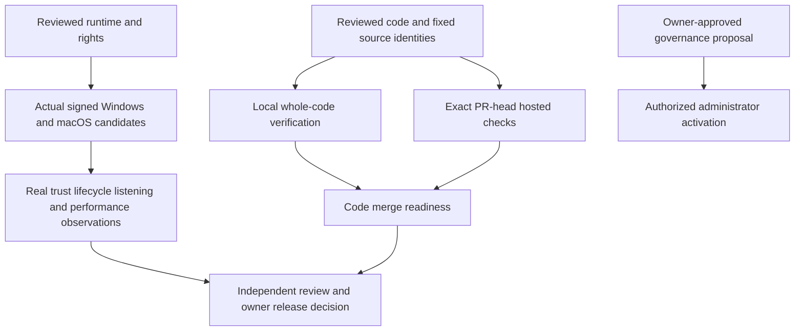

# Issue execution evidence — 2026-11-11

This record separates implemented code, observed verification and outstanding
owner/platform acceptance. It does not approve an installer or release. The
latest published source release remains v0.4.0; the exact source/asset decision
for historical [PR #129](https://github.com/bynanci/open-film/pull/129) remains separate.

## Source and delivery identities

| Scope                                  | Exact identity / record                                                                                                                                                    |
| -------------------------------------- | -------------------------------------------------------------------------------------------------------------------------------------------------------------------------- |
| Original implementation baseline       | `08e38b6a63a0b0fbcfd3a073c8bfa5dcc8c08224`                                                                                                                                 |
| Issue plan                             | [PR #147](https://github.com/bynanci/open-film/pull/147), merged as `dd3af6ce38d7577cc4aec5e184b76fc14f459d6d`                                                             |
| CI/source guards and measured profiler | [PR #148](https://github.com/bynanci/open-film/pull/148), tested source `d008d01abfc8cf402fb3ed0d8fcbdf7acec6a9c3`, merged as `338b3c4a5fbee3627bc0b75df3e77277230d04bc`   |
| Read-only SDK capsule                  | [PR #149](https://github.com/bynanci/open-film/pull/149), tested delivery `4d68d526cc0139bb8b857334d0d70c33959c037b`, merged as `c8feabcd58ff34b378097821ff92bbeb3517b941` |
| Native receipt/runtime intake          | [PR #150](https://github.com/bynanci/open-film/pull/150), tested delivery `336a16f513b7f737833587b068a846a7e5e0ac24`, merged as `14fa800748f6c2026ac06f82354369602b1c7d26` |
| Final integrated delivery              | [PR #151](https://github.com/bynanci/open-film/pull/151); its current head, checks and merge status are the live final-head record                                         |
| Local whole-code verification          | PR #151 source `247d4faf8d7be673b6b809d1e3146e3659d0a505`; later source changes require their own final-head gates                                                         |

PR #151 includes the reviewed SDK/native branches so its checks can exercise the
whole code set. #149 and #150 are merged; their shared changes leave its diff. A passing local integration run is not a passing future PR-head CI run.
The document uses the live PR record rather than embedding its own commit hash.

## Observed local verification

Source `247d4faf8d7be673b6b809d1e3146e3659d0a505` passed `pnpm test`: **467 files /
6,151 tests**, exit 0, **601.36 s**. Earlier private integrations passed 6,109
and 6,114 tests; those historical results are not substituted for this run. The 1,548 contract
tests below are a subset, not an additional full-suite total.

All 20 commands below exited 0 against that same `247d4fa` source:

| #   | Command                                                                                     | Evidence scope                                    |
| --- | ------------------------------------------------------------------------------------------- | ------------------------------------------------- |
| 1   | `pnpm format:check`                                                                         | Complete checkout formatting                      |
| 2   | `pnpm test:i18n`                                                                            | Existing UI locale contracts                      |
| 3   | `pnpm test:docs-i18n`                                                                       | README locales and byte-identical English mirrors |
| 4   | `pnpm test:license`                                                                         | Existing Apache-2.0/NOTICE governance             |
| 5   | `pnpm test:provenance`                                                                      | DCO policy regressions                            |
| 6   | `pnpm lint`                                                                                 | Complete checkout lint                            |
| 7   | `pnpm typecheck`                                                                            | TypeScript and desktop Vue types                  |
| 8   | `pnpm test:ci-partition`                                                                    | Contract/media inventory coverage                 |
| 9   | `pnpm test:browser-partition`                                                               | Complete six-shard browser inventory              |
| 10  | `pnpm test:contracts`                                                                       | 81 files / 1,548 tests                            |
| 11  | `node --test scripts/ci/tests/source-head.node.mjs scripts/ci/tests/media-profile.node.mjs` | Actual source identity and profiler guards        |
| 12  | `python3 scripts/ci/tests/media-profile-process.py`                                         | Four process/provenance regressions               |
| 13  | `python3 scripts/native/test-prepare-runtime-inputs.py`                                     | Four authenticated intake cases                   |
| 14  | `python3 scripts/security/test-verify-glib-source.py`                                       | 26 source verifier cases                          |
| 15  | `python3 scripts/security/test-verify-glib-closure.py`                                      | 14 closure verifier cases                         |
| 16  | `python3 scripts/security/test-run-glib-controls.py`                                        | 19 supervisor/control cases                       |
| 17  | `python3 scripts/security/test-audit-native.py`                                             | 10 audit/retained-bundle cases                    |
| 18  | `python3 scripts/security/test-native-admission.py`                                         | 30 admission policy cases                         |
| 19  | `python3 scripts/native/test-extract-runtime.py`                                            | Two bounded extraction cases                      |
| 20  | `python3 scripts/native/test-archive-candidate.py`                                          | One candidate archive case                        |

Rows 14–18 total **99 security cases**; rows 13, 19 and 20 total **seven intake,
extraction and archive cases**. These fixtures do not certify real target bytes.

Additional final-integration checks passed: `pnpm build`, built CLI smoke,
`pnpm test:interchange` with **18 official OpenTimelineIO checks**, **11 actual
pinned-SDK application/CLI checks**, and the real documentation build (**13.886 s**).
The SDK command uses `scripts/storytelling-compat.vitest.ts` and requires the
explicit SDK checkout/binary digest documented in the [capsule record](storytelling-compatibility-138.md).
Resolve/FilmCraft import, hardware quality and production SDK execution were not
inferred from these checks. No production optimization is claimed from the
[fixed-source profile](media-test-profile.md).

**Not run locally:** complete `pnpm test:e2e`; final-head browser verification
belongs to the linked PR checks. PR #148's six downloaded reports independently
passed the existing candidate/partition validator: **363 browser cases**, on
that PR's exact source. Its [Verify run](https://github.com/bynanci/open-film/actions/runs/43004110417),
Windows recovery and three-platform Render QA passed. These earlier results do
not replace PR #151's own final-head gates. Local `pnpm test:native` was not run
because GTK/WebKit development prerequisites are absent. Hosted native-shell CI
and native installer/workstation acceptance are distinct observations.

## Browser synchronization follow-ups

PR #150's earlier `5dacfed` Verify failed one en-US import smoke case while
60 shard cases passed. Its trace selected a hidden file input while the visible
Add Files control was disabled by the initial readiness request; no upload was
submitted. A controlled red reproduced the exact original 15-second missing
import-button failure, and a semantic enabled-control wait passed the full
workflow. The final affected smoke spec passed all three locales in three
rounds, **9/9**. A preliminary diagnostic with invalid route cleanup was
retained and excluded from that proof.

A real Chromium follow-up also demonstrated a separate assertion-failure cleanup
race in the reopened-transcript test: unroute could race the held fulfillment.
The parallel sequence failed 10/10; settling the captured read before removing
the handler was clean 10/10. The browser-only corrections and their exact final
checks are tracked in [PR #150](https://github.com/bynanci/open-film/pull/150) and
[PR #151](https://github.com/bynanci/open-film/pull/151). Original assertions,
timeouts, retry counts and source checks remain intact. These findings do not
retroactively turn the earlier failed Verify into a pass or replace final-head
six-shard verification. The 6,151-test run above does not include Playwright.

A later `04cc127` Verify exposed a separate cancellation-test contract mismatch:
the real import correctly retained a completed photo and showed Organize memories,
while the test unconditionally required the empty-Library Add more media action.
The correction first observes a positive real catalog and the same new import
job still queued/running, then requires that job's successful cancellation,
retention and visible cards for every pre-cancel asset, unchanged originals and
project title, and recovery through the exact persistent Add media toolbar.
The controlled original assertion failed at its original five-second boundary;
the corrected focused case passed **3/3**, and the complete affected desktop
spec passed **3/3**. No production UI or import-engine change was required.
Current candidate and complete hosted results remain the linked PR records.

The later collect-coverage failure occurred in teardown after its assertions
passed: a direct API connection was idle for 6,001.291 ms, matching Node's
5,000 ms keep-alive timeout plus 1,000 ms buffer. Controlled eviction at the
actual HTTP agent's reuse boundary reproduced five stale-connection failures;
five fresh owned contexts returned HTTP 200. Ordinary earlier eviction attempts
reconnected and were retained as inconclusive. The actual ja-JP case reproduced
the same teardown failure, then passed with a fresh strict cleanup context.
The fixture sends one close request, rejects non-200 responses without a busy
fallback or retry, disposes its context, and attempts every ordered stop callback
while preserving failures. Six new real HTTP/lifecycle regressions plus three
existing transport cases passed; all three collect locales passed with unchanged
test bodies. These six new tests are included in the 6,151-test snapshot above.

## Native inline review closure

The all-green earlier native candidate still had two supported real-build gaps
identified by inline review. Generated contributor IDs were incorrectly passed
to physical file pinning. The fix shares the existing build resolver only for
artifact input records, preserves original IDs, and retains physical-path/hash,
package identity, hard-link and inventory bounds. An actual production build's
50 artifacts and 698 input occurrences, including five generated IDs, passed
without changing the contribution receipt bytes; unsafe local dependency hard
links were materialized only inside the isolated verification input tree.

The default Cargo release shell can also share an inode with `release/deps`.
The default candidate command now prepares an independent byte-identical shell
at the same known build path before strict pinning, preserving its mode,
compiler identity and later seal/sign/archive subject. Custom identity inputs
and ordinary pinning retain hard-link rejection. Source/path race, symlink,
exclusive-copy and rename-failure checks remain fail-closed. The original runtime
and dependency alias bytes stay unchanged. The two-fix packet passed 219 focused
tests plus typecheck, lint, formatting, inventory and license checks; independent
review and final-head gates are recorded in PR #150/#151. Signed-byte simulations
are structural tests and provide no real OS signature or distribution approval.

## Actual source-security producer evidence

The actual [Dependency Security run 43023766217](https://github.com/bynanci/open-film/actions/runs/43023766217)
passed native source admission at exact source
`247d4faf8d7be673b6b809d1e3146e3659d0a505`. The authenticated
[artifact 13857560229](https://github.com/bynanci/open-film/actions/runs/43023766217/artifacts/13857560229)
was independently downloaded and pinned as ZIP SHA-256
`949eb3808995ab4d2130340edaf0fc33b6c8387853dfb16fbdcc97142eccaab7`.
The ordinary, visible `advisory-db.bundle` is **922,889 bytes**, SHA-256
`2fdf3703ccb60814cb807fd1a56d651d268ea1031c3a5690414301e3f8f02ae5`.
An independent offline bare clone recovered database commit
`fd6f39814c4d3c359fdbe223d0280dec4933f78f`, matching the retained audit.
Compared with the retained earlier `901cf64` snapshot, five hickory-proto advisories
were added (1,453 to 1,458 records); that package is absent from the captured
metadata and all three lockfiles. Scanner 0.22.2 and candidate warnings were
unchanged. This is an observed database update, not a blanket risk clearance.
The artifact needs no hidden `.git` entries. Actual source/closure/lock/audit byte
pins and admission evaluation were independently reconciled. The actual patched
audit has no vulnerability records; the upstream control findings and retained
`proc-macro-error` maintenance warning are not silently cleared.

**Complete actual external receipt replay remains blocked:** unchanged source
metadata requires the original absolute checkout path. This host cannot create
`/home/runner` (permission denied; no sudo); the actual replay stopped before
cloning. No metadata rewrite, path substitution or privilege workaround was used.
Fresh independent-checkout fixture replay passed, and hosted full admission
passed at its own original path; neither is called a successful complete external
replay of this actual artifact. See the [receipt contract and safe assembly
constraints](../validation-native-candidate-receipt.md).

## Issue scope and remaining gates

| Issue                                                   | Implemented / observed                                                                                                                   | Still open                                                                                                                                                                     |
| ------------------------------------------------------- | ---------------------------------------------------------------------------------------------------------------------------------------- | ------------------------------------------------------------------------------------------------------------------------------------------------------------------------------ |
| [#138](https://github.com/bynanci/open-film/issues/138) | Read-only finite-profile capsule; unchanged Catalog/project/source checks and 11 actual-SDK tests                                        | Bounded issue closed after #149 passed all 18 checks and merged; production adapter/writer and FilmCraft acceptance remain separate                                            |
| [#139](https://github.com/bynanci/open-film/issues/139) | Fixed-source profiling, process/provenance fixes and source-bound CI merged in #148; bounded issue closed                                | No production speedup or unmeasured optimization claim                                                                                                                         |
| [#140](https://github.com/bynanci/open-film/issues/140) | Versioned pre-trust/final-byte receipt and original evidence reconstruction; Windows/POSIX Cargo replay and final handoff fixes reviewed | Actual complete final receipt, external replay, target observations and independent acceptance                                                                                 |
| [#141](https://github.com/bynanci/open-film/issues/141) | Authenticated runtime intake, target staging producer and read-only upstream metadata                                                    | Actual reviewed target runtime inputs, complete rights/license/SPDX, artifact IDs/manifests and OS execution                                                                   |
| [#142](https://github.com/bynanci/open-film/issues/142) | Windows operator/evidence handoff prepared                                                                                               | Real signed candidate, trust, clean install, update failure/rollback and project-preserving uninstall                                                                          |
| [#143](https://github.com/bynanci/open-film/issues/143) | macOS operator/evidence handoff prepared                                                                                                 | Real signing/notarization, trust, clean install, update/rollback and uninstall                                                                                                 |
| [#144](https://github.com/bynanci/open-film/issues/144) | CC0 recorded dialogue/guitar objective Silence pipeline, MP4 decode, exact PCM/WAV and cold reopen proof                                 | Human annotation/listening, 1,152-sample / 24 ms excluded-tail acceptance, native devices, recorded A/V synchronization, >2 captured channels and live browser lifecycle cases |
| [#145](https://github.com/bynanci/open-film/issues/145) | Candidate-bound measurement handoff prepared                                                                                             | Installed cold startup, repeated launch, one-hour memory and long-form/4K/GPU workstation observations                                                                         |
| [#146](https://github.com/bynanci/open-film/issues/146) | Tested CI/source-head guards and concrete ruleset/rollback proposal                                                                      | Owner approved fixed proposal207bc7f after this PR round; administrator activation, safe control cases and role attestations remain open; no settings changed                  |

[Issue #7](https://github.com/bynanci/open-film/issues/7) remains the real-media/
workstation umbrella. The [native operator handoff](../operations/native-platform-handoff.md)
and [proposed merge controls](../governance/merge-controls-operator-handoff.md)
retain their independent gates. No signer, certificate, notarization, runtime
rights decision, human listening judgment or owner approval was invented.

Code merge readiness does not satisfy the runtime, workstation, governance or
release-owner branches of this evidence flow.
