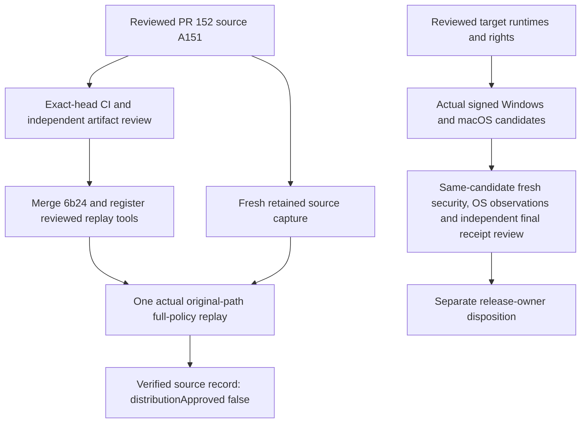

# Native source replay and governance follow-up — 2026-11-12

This dated record closes the actual source-only replay verification gap. It does
not accept a native installer, grant runtime redistribution rights, certify a
workstation or publish a source Release. The latest public source Release remains
v0.4.0; the exact archive/maintenance-warning decision for Draft
[PR #129](https://github.com/bynanci/open-film/pull/129) remains separate.

## Reviewed source and delivery

| Scope                                                             | Exact identity                                                                                                |
| ----------------------------------------------------------------- | ------------------------------------------------------------------------------------------------------------- |
| PR #152 base                                                      | `9f4abb8de6f8f20b080c59dd50f1cd64af9dc2d5`                                                                    |
| Reviewed/tested PR #152 source                                    | `a151b3835c68c946841b222b1b1a9e42e37b50bf`                                                                    |
| Merge of [PR #152](https://github.com/bynanci/open-film/pull/152) | `6b24a38579a465040978e6ff63340b1b7d8b73ce`                                                                    |
| Tested and merged tree                                            | `6fcf6e6e9f194eb954b49c107a0626b2cacfe5ed` (exact match)                                                      |
| Source capture                                                    | [43123535371](https://github.com/bynanci/open-film/actions/runs/43123535371), attempt 1; workflow `388399253` |
| Actual original-path replay                                       | [43126434946](https://github.com/bynanci/open-film/actions/runs/43126434946), attempt 1; workflow `415305660` |

All 21 latest exact-head check-runs were successful before the guarded merge;
all review threads were resolved and `closingIssuesReferences` was empty.
Changing the ordinary phrase `fixed #146 policy` to `#146 policy` removed an
unintended GitHub closing-keyword link. Issues #7 and #140–#146 remain open for
their actual unfinished scopes. The already-corrected PR #151 automatic closure
is preserved in the issue history, not treated as policy activation.

## Actual CI recovery and output validation

The first two PR #152 attempts failed before browser/media workloads because
runners could not resolve Ubuntu archive hosts; native also failed Azure archive
DNS. Those failures remain historical evidence. After the three official Ubuntu
HTTPS endpoints returned 200 and the fixed FFmpeg package bytes matched their
reviewed SHA-256, one whole Render attempt 3 established actual GitHub Linux
recovery. Only then was whole Verify attempt 3 requested. No source, tool pin,
assertion, timeout, mirror, resolver, proxy, TLS or GPG policy was changed.

| Verification                                                                                              | Actual result at exact PR source                                                                                                                                                              |
| --------------------------------------------------------------------------------------------------------- | --------------------------------------------------------------------------------------------------------------------------------------------------------------------------------------------- |
| [Verify 43045132549, attempt 3](https://github.com/bynanci/open-film/actions/runs/43045132549/attempts/3) | All 11 jobs succeeded                                                                                                                                                                         |
| Contracts and media                                                                                       | 81 files / 1,548 contracts plus 386 files / 4,603 media tests = 6,151 Vitest tests; conversion preflight cases are already included in that total                                             |
| Six browser shards                                                                                        | 363 actual cases; 61/61/61/60/60/60; zero skips, retries, flaky or unexpected cases; original checker passed independently and in hosted aggregate                                            |
| Native archive Python                                                                                     | 7 extractor + 1 archive + 18 new replay cases passed                                                                                                                                          |
| Hosted Linux native shell                                                                                 | fmt, clippy with `-D warnings`, 23 Rust unit tests, 5 GLib controls and locked build passed; zero failed/ignored Rust tests                                                                   |
| [Render 43045132199, attempt 3](https://github.com/bynanci/open-film/actions/runs/43045132199/attempts/3) | Linux x64, Windows x64 and Darwin ARM64 plus aggregate succeeded; independently pinned report ZIPs passed the unchanged checker: 351 measurements / 30 controls, `workstationVerified: false` |
| Windows media recovery                                                                                    | The same source's existing Windows job passed; this is not Windows installation/trust acceptance                                                                                              |

Original ZIPs, JSON reports, source/head/attempt metadata and job logs were
independently retained and hashed. Discovery/partition counts were kept separate
from actual execution. Local focused Python replay tests also passed 18/18;
local full E2E and full `test:native` were not run. The hosted native execution
above is real and separate. Local Node 24.19.0/pnpm 11.19.0 differed from hosted
Node 24.14.0/pnpm 11.11.0; no exact local-toolchain reproduction is claimed.

The merged main's separate [Verify 43126349598](https://github.com/bynanci/open-film/actions/runs/43126349598),
[Render 43126349721](https://github.com/bynanci/open-film/actions/runs/43126349721)
and [Windows recovery 43126349688](https://github.com/bynanci/open-film/actions/runs/43126349688)
are live exact-main records; their completion is not inferred from PR checks.
The existing Pages workflow also ran automatically after the main merge. No
manual Release, tag, native-package publication or signing operation was initiated.

## Fresh retained capture and complete actual replay

The older `9982284` source capture expired on 2026-11-11 at 19:37:27.744045Z and
was neither reused nor retimed. The new capture used the exact reviewed A151
source, authenticated same-repository workflow/run/artifact identities and the
unchanged authority.

| Evidence                                                                                                           | Actual pin                                                                                            |
| ------------------------------------------------------------------------------------------------------------------ | ----------------------------------------------------------------------------------------------------- |
| [Source artifact 13901154982](https://github.com/bynanci/open-film/actions/runs/43123535371/artifacts/13901154982) | 3,672,132 bytes; ZIP SHA-256 `5e2771382475508388e196f1a998ba04404817bde1bf7c777a83164373dcf3e2`       |
| [Replay artifact 13903537255](https://github.com/bynanci/open-film/actions/runs/43126434946/artifacts/13903537255) | 8,745,895 bytes; ZIP SHA-256 `66b1f0337fcbef7b3fd0e03cef549e73d5469c8dc22a76be1f68e8b25582f783`       |
| Payload                                                                                                            | 7,471,847 bytes; SHA-256 `b1bf6dc484091441f25fd027107f184aa288ae370bff320b80f0a12e9cad2817`           |
| Advisory database                                                                                                  | `fd6f39814c4d3c359fdbe223d0280dec4933f78f`; fetched 2026-11-12T00:03:43.513366Z                       |
| Strict freshness deadline                                                                                          | 2026-11-12T06:03:43.513366Z; actual replay completed before this deadline                             |
| Tool / subject                                                                                                     | Main `6b24a38579a465040978e6ff63340b1b7d8b73ce` / original A151 source; these are separate identities |
| Original source path                                                                                               | `/home/runner/work/open-film/open-film`, on a fresh isolated Linux runner                             |

The independent reviewer authenticated and safely extracted the replay artifact,
verified the six identical policy identities and all 16 raw pins, and compared
the embedded original ZIP and payload byte-for-byte with the reviewed capture.
The entire replayed admission equalled the original admission; replay stderr
was empty. The actual job retained `status: source-replay-verified` and
**`distributionApproved: false`**. No project JavaScript/HTML, artifact code,
private media or remote provider ran. Original metadata, paths, scan bytes and
timestamps were not rewritten. Candidate Git history and historical source/lock
objects retained their full-history requirements.

The repaired actual graph had 431 dependencies and no vulnerability/unsound
records. Both registry controls retained their expected GLib unsound finding;
the actual/current/historical raw scans exited 0/1/1. The existing
`proc-macro-error` 1.0.4 maintenance warning (`RUSTSEC-2024-0370`) remains recorded;
this evidence does not decide the source Release owner's exception.

### Database snapshot boundary and additional failed check

The producer explicitly captures a depth-one database and never fetches more
history. Its retained bundle is SHA-256
`2fdf3703ccb60814cb807fd1a56d651d268ea1031c3a5690414301e3f8f02ae5`.
Two independent reviews rehashed all 2,503 current-snapshot Git objects
(1 commit, 1,025 trees, 1,477 blobs; 1,767,563 expanded bytes); all hashes and
all 1,438 retained advisory files matched. The HEAD/tree content used by the
original three scans is complete.

An additional `git fsck --full` on the offline bare clone **failed, exit 2**:
the bundle does not preserve the original shallow-boundary metadata, so its
HEAD points to omitted parent `2c684a5d6746d4508eff9e3cb529b3e33f56d438`.
No current tree/blob is missing or corrupted. This is not full database ancestry
verification and is never reported as a pass; `git bundle verify` alone is not
proof of that history. The current bounded admission/replay contract uses the
complete reviewed HEAD snapshot and original raw scans, not ancestor traversal.
This limitation does not waive full candidate-repository history checks.

Future support for generic Git/history consumers should version the capture,
pin the producer's original shallow-boundary bytes and faithfully restore them
in a fresh clone before checking connectivity. Legacy 16-pin captures must stay
legacy; do not synthesize boundaries, repair original bytes, refetch history,
retime evidence or relax policy equality to relabel this observation.

## Approved governance scope and remaining acceptance

The [operator handoff](../governance/merge-controls-operator-handoff.md) now records
the existing fixed-policy owner approval and the original unsuccessful POST,
instead of asking for the same approval again. Proposal `207bc7f…` and rollback
`3da5185…` bytes are unchanged. A resumed read-only protection request at
2026-11-12T00:00:44.627648Z still returned HTTP 403; repository rulesets were empty.
There was no new administration write, credential, bypass or policy change.

| Issue       | Remaining evidence / dependency                                                                                                                                |
| ----------- | -------------------------------------------------------------------------------------------------------------------------------------------------------------- |
| #140        | Same-candidate final native receipt, signed final bytes, target observations and independent acceptance; the actual source-only replay subtask is now verified |
| #141        | Actual reviewed target runtimes, complete compiled-source/build/license/SPDX/source-offer/relink closure and redistribution disposition                        |
| #142 / #143 | Genuine Windows/macOS signed candidate, OS trust/notarization and clean install/update-failure/rollback/project-preserving uninstall                           |
| #144        | Human annotation/listening, explicit 1,152-sample/24 ms frame-aligned MP4-tail acceptance, native device A/V sync and captured multichannel evidence           |
| #145        | Installed cold/warm launch, repeated measurements, one-hour memory, long-form/4K/GPU/external-storage/input observations                                       |
| #146        | Existing administrator's actual unchanged-policy activation, safe controls, alerting/release/signing-role attestations                                         |
| #7          | Real-camera/HDR/MotionPhoto, Resolve/FilmCraft and cross-workstation/media/hardware umbrella                                                                   |

No accessible Windows/macOS execution endpoint was established. A cloud native
build, browser report or synthetic benchmark preparation does not replace these
observations. PR #129 remains Draft; its exact source/asset/maintenance-warning
owner disposition is independent of development merges.

An eventual final receipt still needs its own same-candidate fresh security
records. This dated source replay is not an indefinitely reusable approval.
