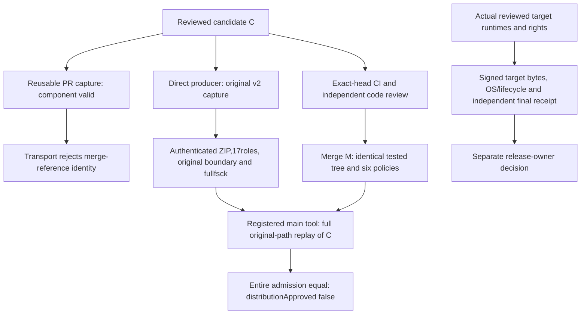

# Verified native v2 replay and remaining gates — 2026-11-12

This record completes the bounded runtime input-parity and audit-v2 source replay
work. It does not accept a native installer, grant runtime redistribution rights,
resolve the source Release owner's maintenance exception or certify a workstation.
The latest public source Release remains v0.4.0; PR #129 stays Draft.

## Reviewed development changes

| Scope                             | Exact identity                             |
| --------------------------------- | ------------------------------------------ |
| PR #154 base                      | `81714e287a76aac1e46b6bea7e1806a408aa9a63` |
| PR #154 tested head               | `f8f4cc8b9eae20098aede4c84320716e305b6218` |
| PR #154 merge                     | `5c2cf241c16aa06ac48248c8d21c042c2e1fd943` |
| PR #154 tested/merged tree        | `eb192e4be1aae97a24cce424aa757b4a8af8a915` |
| PR #155 base                      | `5c2cf241c16aa06ac48248c8d21c042c2e1fd943` |
| PR #155 tested source candidate C | `18eef0e3d07e0c0a8fc05027ef30574db3a821d2` |
| PR #155 merge / replay tool M     | `a70f96f1781f6984e140cfd5d4860134c187a003` |
| PR #155 tested/merged tree        | `4485b9813a5b127d9489e7f26f0f7f9944e45909` |

Both merges preserved the exact reviewed/tested tree, used the expected PR head,
and had no unresolved review threads or closing issue references. Independent
task and fresh whole-branch reviews found no open Critical/Important/Minor issues.
Commits use the authorized NAN CHUN WANG sign-off. This is DCO attestation, not a
native code-signing certificate or release approval.

[PR #154](https://github.com/bynanci/open-film/pull/154) reuses the strict existing
read-only inspector before direct reviewed staging side effects. Its 29 new
real-filesystem cases had an actual 28-failure/1-pass RED, then 29/29 GREEN;
existing 79 tests and the portable-fixture 43-test follow-up passed. Explicit
test-only FFmpeg wrappers and later attribution/linkage/rights gates remain.

[PR #155](https://github.com/bynanci/open-film/pull/155) integrates audit-v2
producer/consumers with the original shallow boundary, all 17 payload roles and
existing six-authority admission. Final focused Python tests passed 17/33/20;
real TS/Python and candidate tests passed 42. Exclusive output, original DB index
immutability, malformed/stripped captures and duplicate scanner roles are covered.
No source media, project schema, Timeline, Mixer or application Job engine changed.

## Actual exact-head CI

| Source                   | Completed verification                                                                                                                                                                                                                                                                                                                                                                                                                                                                                                                                                                                                                                                                                       |
| ------------------------ | ------------------------------------------------------------------------------------------------------------------------------------------------------------------------------------------------------------------------------------------------------------------------------------------------------------------------------------------------------------------------------------------------------------------------------------------------------------------------------------------------------------------------------------------------------------------------------------------------------------------------------------------------------------------------------------------------------------ |
| PR #154 head             | Independent audit snapshot: 17 successful check-runs; final pre-merge readback: 18 successful checks including an additional DCO run. [Verify 43178057199](https://github.com/bynanci/open-film/actions/runs/43178057199), [Render 43178057079](https://github.com/bynanci/open-film/actions/runs/43178057079), [Windows 43178057093](https://github.com/bynanci/open-film/actions/runs/43178057093), [DCO 43178057515](https://github.com/bynanci/open-film/actions/runs/43178057515)                                                                                                                                                                                                                       |
| PR #154 Vitest           | 1,548 contracts + 4,632 media = 6,180 tests in 468 files                                                                                                                                                                                                                                                                                                                                                                                                                                                                                                                                                                                                                                                     |
| Actual merged main 5c    | Its own [Verify 43181029985](https://github.com/bynanci/open-film/actions/runs/43181029985), [Render 43181030010](https://github.com/bynanci/open-film/actions/runs/43181030010), [Windows 43181029868](https://github.com/bynanci/open-film/actions/runs/43181029868) and Pages completed successfully; 17 checks passed independently                                                                                                                                                                                                                                                                                                                                                                      |
| PR #155 head             | Independent audit snapshot: 20 successful checks including the direct source producer; final pre-merge readback: 21 successful checks including an additional DCO run. [Verify 43181661784](https://github.com/bynanci/open-film/actions/runs/43181661784), [Render 43181661733](https://github.com/bynanci/open-film/actions/runs/43181661733), [Windows 43181661974](https://github.com/bynanci/open-film/actions/runs/43181661974), [DCO 43181661620](https://github.com/bynanci/open-film/actions/runs/43181661620), [Dependency 43181661893](https://github.com/bynanci/open-film/actions/runs/43181661893), [direct source 43184046290](https://github.com/bynanci/open-film/actions/runs/43184046290) |
| PR #155 Vitest           | 1,548 contracts + 4,635 media = 6,183 tests in 468 files; the 12 conversion preflight cases are additional repeated execution, not extra unique tests                                                                                                                                                                                                                                                                                                                                                                                                                                                                                                                                                        |
| Both browser/Render sets | Original reports independently passed unchanged checkers: 363 actual browser cases, zero skips/retries/flaky/unexpected; 351 Render measurements/30 deliberate controls and 180 decoded frames per platform                                                                                                                                                                                                                                                                                                                                                                                                                                                                                                  |
| Windows / native         | Windows 140 tests in13 files + 14 browser cases; native Rust 23 + 5 controls, fmt/clippy/locked build; PR #155 archive Python 7 + 1 + 20; actual source fault suites26/14/19/17/33                                                                                                                                                                                                                                                                                                                                                                                                                                                                                                                           |

All referenced CI/source runs completed on attempt 1; readiness triggered a separate successful DCO run for each PR. Original ZIPs, API IDs/digests, logs, source/head/attempt metadata and report
manifests were independently retained. JavaScript advisory scanning reported zero
known advisories; its default PR merge checkout was recorded separately from the
native producer's explicit C checkout. Upstream GLib remains affected; actual
patched scan passes while registry controls retain the expected unsound finding.
The proc-macro-error 1.0.4 maintenance warning RUSTSEC-2024-0370 remains visible.
No source Release exception is decided here.

The merged M's own [Verify 43185709481](https://github.com/bynanci/open-film/actions/runs/43185709481)
completed successfully on attempt 1, with all 11 jobs passing. Its separate
[Render 43185709760](https://github.com/bynanci/open-film/actions/runs/43185709760),
[Windows 43185709435](https://github.com/bynanci/open-film/actions/runs/43185709435)
and Pages also succeeded. These are actual post-merge M results, independently
queried rather than inferred from the PR.

## Preserve the rejected capture; use supported provenance

The successful reusable PR source run 43181661893 emitted artifact 13926663547
(3,699,160 bytes; SHA-256
`f0a7a5b6ded2add4df51e457cc5b963dfd6bed7bca7adfdb25d01147f2689320`).
Its payload, database and admission component checks passed. Unchanged transport
policy nevertheless rejected it: the native workflow reference points to PR merge
`4b1fc5f99e69af27ee0167d5aa846cefcac2144b`, rather than C. A successful producer
status does not waive that explicit identity guard. The rejection, original ZIP
and original timestamp remain preserved.

One new capture used the existing directly registered native-security.yml
workflow 411241844 at exact C. This is a separate actual fetch/scanner observation,
not a retimed artifact or retry-until-green policy change.

| Accepted direct evidence     | Original value                                                                                                                 |
| ---------------------------- | ------------------------------------------------------------------------------------------------------------------------------ |
| Source run                   | [43184046290](https://github.com/bynanci/open-film/actions/runs/43184046290), workflow 411241844, attempt 1, workflow_dispatch |
| Original artifact            | [13928256972](https://github.com/bynanci/open-film/actions/runs/43184046290/artifacts/13928256972), 3,699,135 bytes            |
| Original ZIP SHA-256         | `cd8bffe09b3127af4c65237548e906918b9daef9afab3e8b7af00a256bd340ed`                                                             |
| Original fetch               | 2026-11-12T08:42:05.440068Z                                                                                                    |
| Unchanged freshness deadline | 2026-11-12T14:42:05.440068Z                                                                                                    |
| DB commit / root tree        | `e57e387b7eb75130ba53e800737107f46344bf2d` / `58df33277e89265876d645c8386336a7ebee7876`                                        |
| Bundle                       | 935,276 bytes; SHA-256 `98d50a042f17b72beaa1cceaf2cf9f24377c092517f522cabb0fc5afea6111ed`                                      |
| Original shallow bytes       | 41 bytes; SHA-256 `29089912ea492c441ca6efa13e07565c78821d7cf5374c1e43056b4af29e2f54`                                           |

Independent unchanged transport checks accepted this direct capture. A new
private bare clone restored those exact original bytes and passed ordinary full
fsck with empty stdout/stderr: 2,519 objects (1 commit/1,028 trees/1,490 blobs),
1,490 current tree files. Nine hidden worktree leaves omitted by artifact upload
remain fully covered in the original bundle. No history was fetched or boundary
synthesized. This validates the faithfully declared shallow snapshot, not full
ancestry. The historical v1/A151 failure/expiry record stays unchanged.

## Actual original-path replay, independently verified

[Run 43186052021](https://github.com/bynanci/open-film/actions/runs/43186052021),
workflow 415305660 attempt 1, used registered main tool M and distinct original
subject C at `/home/runner/work/open-film/open-film`. All six committed policy
identities matched. The full helper enforced a clean nonshallow candidate clone,
its historical source/lock objects, original absolute metadata paths, source,
closure, controls, raw reports, DB snapshot/full fsck and original freshness.
These were actual hosted checks, not a relocated local approximation.

| Actual replay output   | Verified value                                                                                                      |
| ---------------------- | ------------------------------------------------------------------------------------------------------------------- |
| Replay artifact        | [13929105249](https://github.com/bynanci/open-film/actions/runs/43186052021/artifacts/13929105249), 8,810,303 bytes |
| Replay ZIP SHA-256     | `e16f1d1e61bca79f2555ff38c1b190d35eb8c2d921ffb44f6a66dadea3d7b7ba`                                                  |
| Entire 17-role payload | 7,488,922 bytes; SHA-256 `2e733bb5612f6118594ed9c4f2df86c5f05608bfc2bbc6b23bebc763ef5f2321`                         |
| Full replay step       | 08:49:08–08:49:12 UTC; job completed 08:49:17 UTC, before the original deadline                                     |
| Result                 | source-replay-verified; distributionApproved:false                                                                  |

The embedded source ZIP is bit-identical to accepted artifact 13928256972. All
1,591 expanded source files match, and the complete derived 17-role payload equals
hosted bytes. Every six-policy blob/SHA matches C/M. The entire replayed admission
equals the original; replay.stdout is itself byte-identical to original
admission.json, preserving JSON floats, and replay stderr is empty. Independent
review safely extracted/rehashed originals and ran no artifact code locally.
No local source-mode/original-path bypass or local full-admission pass is claimed.

## Local failure evidence and scoped follow-up

The additional local full f8 run completed with 6,177 passes / 3 failures, zero
skips. One NLE case lacked CI-pinned opentimelineio 0.18.1; two Pipeline journeys
hit the unchanged 120s budget. Those original results remain retained. The local
host had Python 3.12.14/FFmpeg 7.1.5 versus core CI's Python 3.12.16/FFmpeg 6.1.1;
Render QA's separately pinned tools are another verification lane.

An isolated venv supplied the exact existing OTIO 0.18.1 prerequisite, without
repository/dependency changes. NLE 65/65, interchange and build passed; the same f8
Pipeline file then passed 4/4 in 92.298s with all assertions/budgets unchanged.
This is an affected-case follow-up, not a rewritten whole-suite pass or proof of
what caused the earlier timeouts.

A separate owned synthetic reproduction demonstrated that the old acceptance
teardown could close/remove its fixture while its exact owned FFmpeg and API
action were still active. It safely aborted/drained afterward. Fixture-only
cancellation/draining is a separate test-cleanup follow-up; no product pipeline,
render quality, test timeout or original assertion is changed by this record.

## Actual remaining gates

Issues #140/#141 remain open for actual reviewed target runtime binaries,
compiled-source/build/SPDX/license/source-offer or relink closure, signed final
candidate bytes and complete independently reviewed native receipts. Issues
#142/#143 retain genuine Windows/macOS trust/signing/notarization, clean install,
first launch, update failure/rollback and project-preserving uninstall. Issue
#144 retains human annotation/listening, MP4-tail acceptance and native A/V/device
observations; #145 retains installed cold/warm/one-hour/long-form/4K/GPU/external
storage measurements; #7 remains the broader workstation/NLE/camera umbrella.

Issue #146's original fixed-policy approval persists, but its actual authorized
POST returned 403 and no policy was created. Existing administrator access and
safe-control/alerting/release-role evidence remain required. No retry without a
capability change, new credential or settings bypass was performed.

Source-only PR #129 still needs its separate exact archive/maintenance-warning
owner disposition. An eventual native candidate needs its own same-candidate
fresh receipt and target evidence; this dated C replay is not indefinite approval.
