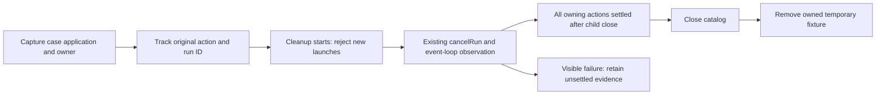

# Owned Pipeline fixture cancellation and drain — 2026-11-12

This is a test-fixture lifecycle correction. Production pipeline, Timeline,
Mixer, Job engine, project schema, rendering and cancellation APIs are unchanged.
The prior local timeout cause is not established by this fix.

## Source and demonstrated gap

The code branch starts at main
`a70f96f1781f6984e140cfd5d4860134c187a003`; task implementation is
`6829235d61a727166efdbec2b2b95d876aca4b04`. A separate owned synthetic reproduction
at the earlier byte-identical acceptance fixture f8f4 showed actual render step6
progress and an MP4 output before teardown. Catalog close/removal returned in
7.972ms while that exact owned FFmpeg child and owning API promise remained
active. Independent cancellation then stopped/drained it; no owned work remained.
This demonstrates the teardown gap, not why the earlier full run timed out.

The original local full result remains 6,177 passes/3 failures. The missing OTIO
prerequisite and later unchanged isolated 65/65 NLE, 4/4 Pipeline and interchange
results are retained separately in [the native evidence follow-up](https://github.com/bynanci/open-film/pull/156).
Neither follow-up is relabeled as a successful original full run.

## Ownership and teardown

A 62-line test-only owner tracks original API promises and run IDs. All startRun,
submitReview and retryRun calls belong to that case's captured application and
owner. Each action receives immediate nonrejecting settlement observers while
its caller keeps the original value/error. New launches are rejected once cleanup
begins, so an older timed-out callback cannot attach to a new fixture.

Review/retry first persist idle before an internal cancellation controller exists.
Cleanup therefore observes the existing idempotent cancelRun API while yielding
event-loop turns until every owned action settles. This starts no new pipeline
work and changes no product retry policy. Existing media.runProcess settles only
on child close; the owning API action supplies the process-drain boundary.

Only then may the catalog close and temporary directory be removed. Pending work
without an application, cancellation failure, close failure and removal failure
remain visible. An unsettled/open fixture is retained on cancellation/close
failure. Fresh optional setup references prevent stale previous-case resources
from being closed after partial setup failure. No PID/proc or process-discovery
API, monkeypatch, global kill or new production drain interface is used.



## Actual RED and GREEN evidence

| Check                           | Observed result                                                                                                                  |
| ------------------------------- | -------------------------------------------------------------------------------------------------------------------------------- |
| Initial behavioral unit RED     | 1 failure: legacy close began without cancellation                                                                               |
| Expanded unit RED               | 7 failures/5 passes across 12 lifecycle cases                                                                                    |
| Real resumed-render RED         | 1 failure: guarded actual close observed pending 1 instead of 0; independent finally cancelled/drained safely before destruction |
| Unit +real regression GREEN     | 13/13 passed in 9.50s                                                                                                            |
| Final affected serial GREEN     | 3 files/17 tests passed in 109.64s: 12 units, 1 real regression and 4 original journeys                                          |
| Original Journey durations      | 37.255s/30.495s/0.369s/33.652s; acceptance file 101.775s                                                                         |
| Full type/lint/format/partition | Passed; 470 files partitioned into 81 contracts / 389 media                                                                      |

RED used an extracted legacy close/remove implementation with ownership tracking;
a missing module was not counted as a behavior failure. Initial RED shell
wrappers ended with tail, so their wrapper exit 0 is not represented as a command
exit 1; retained Vitest summaries show the actual assertion failures. Final GREEN
wrappers propagated the real command exit code0. No failing result was removed.

The real regression imports ten seconds of physical synthetic voice, pauses at
step 3, resumes through existing submitReview, and waits for typed catalog render
progress greater than zero. A sentinel failure exercises cleanup. Before actual
catalog close it requires a settled cancelled action and validated durable
cancelled run state; afterward pending count is 0, the fixture is removed, one
settlement callback remains one, and the exact original sentinel is preserved.
The close boundary guard keeps the real RED catalog open for safe independent
recovery. No fake renderer substitutes for FFmpeg.

All 19 original assertion statements were compared byte-for-byte to the baseline
and remain unchanged. The original four journeys still render the ten-second
1920×1080/30fps project, including all three full renders in successful production
journeys. Test/hook 120s budgets, retry policy and media assertions are unchanged.
This is not a production render speedup or a completed performance benchmark.

Focused commands, run serially to avoid unrelated host load:

```sh
pnpm exec vitest run tests/unit/pipeline-fixture-owner.test.ts tests/integration/pipeline-fixture-cleanup.test.ts tests/integration/pipeline-workbench-acceptance.test.ts --maxWorkers=1 --no-file-parallelism
pnpm typecheck
pnpm lint
pnpm format:check
pnpm test:ci-partition
```

Local FFmpeg 7.1.5 differs from core hosted FFmpeg 6.1.1; the separate Render QA tool
pins are another lane. Configured full hosted checks remain required at the final
reviewed head. Browser, native hardware, installer, listening and release
acceptance are not established by a test-fixture cleanup result.
