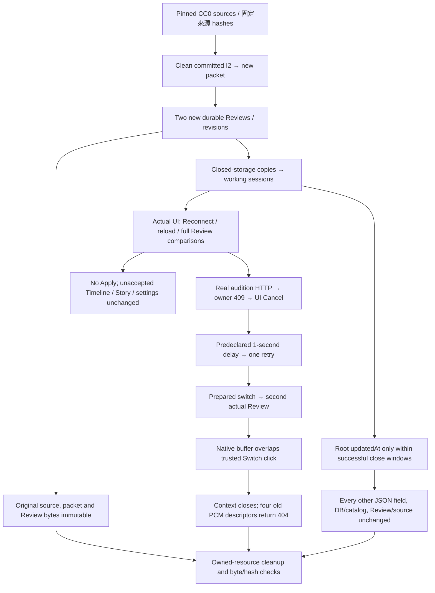

# Recorded-media Silence browser validation — 2026-11-12

## 範圍與結果 / Scope and result

**Linux objective browser checks passed locally; manual quality gates remain.**
本紀錄綁定 I2 `5e9c06d91cb01ff44acae2eb5214e6829b60113a`：新的 CC0 packet 與實際 browser run-02，沒有修改 production engine。
Issue [#144](https://github.com/bynanci/open-film/issues/144) remains open. This uses existing Silence services, Desktop, renderer and native browser Web Audio; it adds no detector, playback or provider engine.
低能量偵測不等於語音 VAD；客觀生命週期通過不代表人工聽感、原生裝置或 release 接受。

| Local evidence / 本地證據                           | Actual outcome                                                                                        |
| --------------------------------------------------- | ----------------------------------------------------------------------------------------------------- |
| Fresh I2 recorded-media packet                      | **exit 0 / 46.962 s**; `objective-contract-pass; manual-review-required`                              |
| Actual I2 browser run-02                            | **exit 0 / 35.919 s**; 9 completed checks, no failures, all 10 cleanup entries passed                 |
| QA state guard TDD                                  | Preserved RED: **4 failed / 29 passed**; corrected GREEN: **33/33 passed**                            |
| Existing pure-contract gate                         | **1,581 passed / 82 files**, 0 failed / pending / todo; partition 471 = 82 contract + 389 media files |
| Human acceptance                                    | `fullyAcceptedQuality: false`; listening and physical output unobserved                               |
| Independent local evidence review                   | **PASS**, exact I2 only, reviewed `2026-11-12T11:52:46.401106+00:00`; no final PR/CI attestation      |
| Final branch review / PR / configured exact-head CI | **Not attested by this local proof**; evaluate the final PR independently                             |

The packet JSON spans `2026-11-12T11:43:07.366Z–11:43:51.282Z`; browser JSON spans `11:43:51.667Z–11:44:27.068Z`.
46.962 s and 35.919 s are external wrapper process durations, retained separately from those JSON intervals.
工具：Linux x64、Node `v24.19.0`、FFmpeg/ffprobe `7.1.5-0+deb13u1`、headless Chromium `151.0.7922.173`。
The [sanitized evidence receipt](https://github.com/bynanci/open-film/blob/main/docs/evidence/silence-real-browser/2026-11-12.json) binds full IDs, hashes, actual close windows and native playback observations.
Existing main H `86afec88978a385c690b547397259c8b077cd85a` CI remains separate; it cannot certify a later documentation/PR head or a local full-suite pass.

## 受保護的流程 / Protected workflow



## CC0 來源與新 Review / Sources and new Reviews

沿用[既有錄音驗證](../validation-silence-real-media.md)記錄的 Commons 作者、description revisions 與 CC0 1.0 宣告；使用相同 bytes，沒有新增所有權或再散布接受主張。
Reuse those documented permissions and attribution with any shared local packet. The runner verifies the pins before deriving media.

| Source             | Description revision | SHA-256                                                            |
| ------------------ | -------------------- | ------------------------------------------------------------------ |
| `paddy-neary.opus` | `976876871`          | `42973f944af32809fe9f7446a7a745d64fe9fc3e51db521902563f7fa2946053` |
| `guitar.ogg`       | `1293865599`         | `d6ff6cafd3025db2e2215b32e3e7e6411fa08a8d2e0fca7c3353b5a4a82523a5` |

| I2 case           | Durable Review ID                                                  | Base revision                                                      |
| ----------------- | ------------------------------------------------------------------ | ------------------------------------------------------------------ |
| natural           | `c6c82bb5e32a51d65bf8586630f0d17505033e4d516895796b407c3e98bf9b56` | `2aa6b9395820032e15acceca1db9749086c040357e91bb212d56108b9e2dca4a` |
| mixed-reuse-speed | `3918b1f983c6d53bb04ff648296c3a5ddd76293cce568bced8e9eea06e72848a` | `a690fbedbe8f25e7dfa97742f43ccb8104fc701e42f02546a296d1e54309a2c2` |

These are newly generated candidate-bound Reviews; neither historical receipts nor equal candidate counts establish identity.
browser 逐項核對真實 Review response、完整有序 source/timeline mapping、checkbox selections、unmapped 狀態與三個 removal summaries；不只比較 IDs。

## 九項實際 checks / Nine actual checks

| Recorded check                                                   | Actual observation                                                                                                                                   |
| ---------------------------------------------------------------- | ---------------------------------------------------------------------------------------------------------------------------------------------------- |
| `initial-review`                                                 | Natural's current durable Review, complete UI mappings and browser response matched                                                                  |
| `reconnect-same-review`                                          | Reconnect retained the same Review / revision                                                                                                        |
| `reload-discovery-same-review`                                   | Reload rediscovered that same waiting Review and matching visible values                                                                             |
| `active-owner-409-before-cancel`                                 | Real close returned `409 jobs.busy` while actual audition HTTP was unfinished                                                                        |
| `real-http-cancel`                                               | `net::ERR_ABORTED`; server response closed unfinished; cancelled UI/focus restored, no late result after 1,000 ms                                    |
| `single-retry-same-durable-review-after-declared-delay`          | Exactly one retry after the declared 1-second delay; request reached server **1,160 ms** after Cancel completed                                      |
| `prepared-switch-correct-second-review`                          | Actual mixed Review replaced natural; two natural PCM descriptors returned 404 and old result disappeared                                            |
| `playing-switch-native-buffer-overlaps-click-and-context-closes` | Actual stereo PCM HTTP 200; native buffer overlapped a trusted Switch click; context closed, no later starts, two mixed PCM descriptors returned 404 |
| `second-review-remains-immutable-after-playing`                  | Mixed's full waiting Review and protected state matched after returning again                                                                        |

Native context 1 played an actual **96,000-frame / 48 kHz / 2-channel / 2-second** buffer, rate 1, detune 0, nonlooping, offset 0.
在真實 trusted Switch click，context time **0.6933333333333334 s** 落於保守播放區間 **[0.33266666666666667, 2.3326666666666664) s**；node 尚未 ended 或 stop。
The native close resolved after the click (`14900 → 14926.10000000149` browser monotonic ms), state `closed`; late starts after close: **0**.
Headless scheduling does not establish physical sound. Cancellation covers actual in-flight HTTP/source verification; FFmpeg phase and instantaneous owner release remain unobserved.
全部 10 項 cleanup 通過；只關閉 owned browser、Vite、server 與 ports，並驗證原始來源/packet bytes。
The browser sent no Analyze / Revise / Apply / Accept / analysis Retry/Recover/Cancel request; it did not edit the unreviewed Timeline.

## 原始失敗與窄 QA 修正 / Preserved failure and narrow correction

I `925b98f51151fb57695e96dd44d8c89f07796d7a` remains **run-01 FAILED**, packet **47.219 s / exit 0**, browser **44.27 s / exit 1**; seven earlier checks were partial evidence.
其 selector 等待 15 秒失敗：wrapped label 包含所有 SELECT options，不能等於 exact 裸字串 `Timeline seam`；mixed prepare 本身已成功。
The correction checks the sole actual `label > select`, exact direct label, complete ordered options and selected index; no timeout increase, sleep, fallback or added retry.
另一個 run-01 assertion 錯把 working `project.json` 當成 byte-immutable；獨立完整比較確認只有正常 close-save 的 root `updatedAt` 改變，其他 JSON/DB/Review/source 均不變。
原始 run-01、receipt、trace、failure screenshot 與兩份 diagnosis 保持原樣；I2 是新候選、新 packet 與新 output，不是把失敗改標成功。

Original source/packet/project/Review trees remain byte-immutable. Working copies may create audition caches and update only root save metadata.
新 pure QA helper 在每次 verify、reopen 與 finally 使用完整 parsed JSON strict equality；只排除 root `updatedAt`，不是一般 metadata 排除。
Both project IDs and canonical ISO timestamps must be valid; changed root time must be nondecreasing and inside an observed successful close window for that actual project.
409、錯誤 project、未知或 nested 欄位、選取/排序/Composition/Story/settings/source 變化、無效或 window 外 timestamp 都會被拒絕。
Raw text hashes and exact timestamps remain reported. Catalog DB and durable Review files have separate unchanged-byte checks; files are never normalized on disk.

| Actual HTTP-200 close window, UTC 2026-11-12 | Root `updatedAt` observed in that window |
| -------------------------------------------- | ---------------------------------------- |
| natural `11:44:11.259–11:44:11.266`          | `11:44:11.260Z`                          |
| mixed `11:44:19.316–11:44:19.324`            | `11:44:19.317Z`                          |
| natural `11:44:22.185–11:44:22.195`          | `11:44:22.186Z`                          |
| mixed `11:44:24.412–11:44:24.416`            | `11:44:24.413Z`                          |

Nine state checks passed: five with unchanged root timestamps and four with only the guarded root save time changed. Full per-check hashes/windows are in the sanitized receipt.
TDD retained the original byte-equality rule: **4 expected failures / 29 passes**, then **33/33** with the narrow helper, including synthetic mutation and invalid-close negatives.
Scoped syntax/lint/type/format checks and the existing 1,581-test contract gate are separate recorded local checks; no full media/full-suite outcome is inferred.

## 重現 CLI / Reproduction

Use installed dependencies/tools, a clean committed reviewed candidate, verified external CC0 inputs, and nonexistent external packet/output paths.
新的 commit 必須產生同 head 的新 packet/Review；不改舊 receipt、不重用 output、不重試到綠燈。The helper `.ts` import requires the existing tsx loader below.

```sh
set -eu
qa_repo=/absolute/path/to/clean-openfilm
qa_head=REPLACE_WITH_REVIEWED_40_HEX_SHA
qa_sources=/absolute/external/path/to/verified-cc0-inputs
qa_packet=/absolute/external/path/to/new-candidate-packet
qa_output=/absolute/external/path/to/new-browser-run
qa_browser=/usr/bin/chromium
cd "$qa_repo"
test "$(git rev-parse HEAD)" = "$qa_head"
test -z "$(git status --porcelain)"
test ! -e "$qa_packet"
test ! -e "$qa_output"
pnpm exec tsx tests/manual/silence-real-media.ts "$qa_sources" "$qa_packet"
node --import "$qa_repo/node_modules/tsx/dist/loader.mjs" \
  "$qa_repo/tests/manual/silence-real-browser.mjs" \
  --repo "$qa_repo" --head "$qa_head" \
  --packet "$qa_packet" --sources "$qa_sources" \
  --output "$qa_output" --browser "$qa_browser"
```

API owns an ephemeral loopback port; the UI exclusively admits `http://127.0.0.1:1420` with `strictPort: true`.
1420 已佔用就保留失敗；不更改 Origin/CSRF policy、不改 UI origin/port、不停止其他程序。CLI 不下載、安裝或上傳素材。

## 保留與未完成 gates / Retention and unfinished gates

Only sanitized summaries, IDs/hashes, timings and this Mermaid diagram enter the repository. Media, projects, private absolute paths/URIs, raw logs, traces and screenshots stay external and are not CI uploads.
The receipt pins the I2 driver `7cbdb216962eb7ee089c6783dcec2e9205976dfc2dc3e2be4c3ddab43a4d1480` and state helper `db97a5beb540a184e1f40c1f1a66da60a2cb619842d43baabaa2cae62b06aaad`.
mixed `qa.frameAlignedAudioTail` **1,152 samples / 24 ms** remains `manual-review-required`; successful export contracts do not accept its termination quality.

1. Human reference annotation, listening, speech/breath/seam/music quality and the excluded tail remain unaccepted.
2. 真實 recorded A/V synchronization remains unperformed; generated color video is not a sync reference.
3. Captured inputs beyond stereo remain unperformed; stereo Web Audio is not multichannel capture proof.
4. Windows/macOS native workstations, physical audio devices/routing and device changes remain unobserved.
5. Clean-machine installation, installer trust, signing/notarization and update lifecycle remain open.
6. Native hardware/GPU, 4K and production performance acceptance remain open.
7. PR129 remains Draft; exact source-owner/archive/maintenance-warning approval remains separate.
8. Issue146 administrator policy activation and control/role attestations remain separate. The existing fixed-policy owner approval stays valid; the recorded authorized POST returned 403 and needs an existing Rulesets administrator with the required capability. This local QA evidence grants no additional administration capability.

As recorded on 2026-11-12, latest published source release remains **v0.4.0**. No release, native cryptographic signing or publication is claimed or authorized.
獨立本地 raw-evidence review 已對 exact I2 判定 PASS；本地紀錄不對最終 whole-branch review 或 configured exact-head CI 作 attestation，須依 final PR exact head 獨立判定。
The 27 unchecked TASKS parent items remain unchecked; only the completed objective Linux recorded-browser child is checked.
