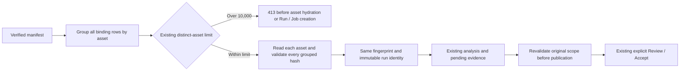

# Common Analysis preparation — 2026-11-12

This is a bounded prerequisite for archive analysis, not completion of background
scheduling. The production change is inside the existing
`SourceAnalysisService.prepare()`. It adds no Timeline, Mixer, Job engine,
provider, persistent cache, project field or Catalog migration.

## Behavior and safety

Previously each distinct asset filtered the complete verified-binding array,
despite an earlier grouping pass. At 10,000 assets / 50,000 bindings this meant
500 million binding-to-asset comparisons **per preparation pass**. Preparation
runs at creation, before analysis and inside the publication guard.

The service now groups complete binding rows once and validates every hash in
the relevant group. Grouping and hash validation take `O(B + A)` work; existing
sorting, Catalog queries, fingerprinting and analysis retain their own costs.
The original binding array remains the fingerprint input, sorted asset hydration
and member-binding order are preserved, and all three independent freshness
checks still execute. There is no cross-call memoization.



The existing limits remain 10,000 distinct assets and 50,000 bindings. The
intentional error-precedence change is that an oversized confirmed scope returns
`request.tooLarge` / HTTP 413 before stale/missing asset or project-coverage
checks. Project confirmation, manifest admission and the binding-count guard
still precede this check. Within-limit stale source rejection stays HTTP 409.
Source files, Composition, locks, User Pins, review decisions and Undo/Redo are
not modified by this change.

## Reproduction and measurement boundary

```sh
pnpm exec tsx scripts/benchmark-source-analysis.ts 1000 5 /tmp/analysis-1000.json
pnpm exec tsx scripts/benchmark-source-analysis.ts 10000 5 /tmp/analysis-10000.json
```

Output paths must be new and outside the checkout. Run the same script bytes on
the old and new source without competing test/compile work. The benchmark
creates temporary SQLite Catalogs using public Catalog methods, including real
occurrences, content identities, sealed bindings and manifests. It performs
actual `createRun`, publication and readback, with one warm-up and three measured
repetitions. Setup is timed separately and excluded from workflow times.

Each run uses five bindings per asset, unique synthetic content hashes, no
perceptual hashes/GPS and capture-time groups of at most 100 assets. Those groups
stay within the unchanged 64 KiB evidence limit. No actual image file, source
hashing, import, FFmpeg decode/encode/seek or provider work is measured. This is
not proof of real-media archive throughput or end-to-end import performance.

A benchmark-only wrapper measures the three existing private preparation calls;
the production service exposes no new diagnostic API. Assertions require a
completed run, three preparations, all input bindings and pending evidence.
Run ID, fingerprint, config hash, ordered input bindings and complete evidence
are compared through semantic SHA-256 across repetitions and paired revisions.
Source hashes and checkout HEAD must remain unchanged during each run.

The measured baseline is main `bc96b292e8fc8eb47b872a49fa27b2ad56ff9221`.
Candidate measurements use that base plus the recorded working-tree patch;
the measured production source bytes, not a later documentation commit, identify
the optimization. Raw reports retain this distinction and the script hash.

Measured production source SHA-256:
`4c467e7196e43446706b9e28c5eb45c80d8c4ef5866b8905209e96319d9509d9`.
The subsequent implementation commit
`d81934a0254513e7b9d945aba3ca64db0e9746d6` retains those exact bytes.
Both revisions used benchmark script SHA-256
`b618076383c0020e92744f382787fd7099bcf0d446966443aee3459fdb3a4754`.

## Comparable results

The [comparison and report hashes](https://github.com/bynanci/open-film/blob/main/docs/evidence/source-analysis-preparation/2026-11-12/official-comparison.json)
record finite observations from the same Linux x64 host: Node 24.19.0,
pnpm 11.19.0, tsx 4.23.15, SQLite 3.53.3 and Intel Xeon Platinum 8573C,
five visible logical CPUs. These are local tools, not a change to the declared
Node/pnpm floors. Reports contain one warm-up plus three measured repetitions;
the table uses medians with wall-time ranges in brackets.

The four repository JSON reports are formatting-only copies of the original
external measurements: every parsed value is identical. The comparison records
both `originalRawSha256` and `repositoryJsonSha256`; original byte receipts remain
outside the checkout. Formatting does not create a new measurement or source
admission receipt.

| Assets / bindings |             Baseline workflow ms |           Indexed workflow ms | Workflow ratio | Baseline / indexed preparation ms | Baseline / indexed CPU ms |
| ----------------- | -------------------------------: | ----------------------------: | -------------: | --------------------------------: | ------------------------: |
| 1,000 / 5,000     |          457.86 [377.08, 470.17] |       192.27 [190.68, 287.94] |          2.38× |                   387.68 / 151.61 |           496.44 / 206.58 |
| 10,000 / 50,000   | 20,759.91 [19,897.14, 29,143.41] | 2,898.93 [2,834.48, 3,128.39] |          7.16× |              20,263.73 / 2,318.90 |      21,014.53 / 3,293.68 |

Both paired sizes have identical fixture hashes and identical complete semantic
result hashes across all repetitions. At the supported upper bound, preparation
was 8.74× faster and the complete metadata-only analysis was 7.16× faster in this
run. This does not establish speedups for all archives or concurrent workloads.
Earlier smoke/pilot outputs are retained externally and excluded from this
comparison; the large pilot overlapped diagnostic/test work and used an earlier
script without the final tool/source-stability receipts.

Memory did **not** improve in these observations:

| Assets / bindings | Baseline / indexed process maximum RSS MiB | Baseline / indexed median post-workflow heap MiB |
| ----------------- | -----------------------------------------: | -----------------------------------------------: |
| 1,000 / 5,000     |                            246.66 / 266.77 |                                    48.84 / 48.91 |
| 10,000 / 50,000   |                            672.26 / 823.31 |                                  125.49 / 198.09 |

These measurements use normal garbage collection. The RSS maximum spans setup,
warm-up and all repetitions, while heap samples are instantaneous. Faster wall
time, different collection timing and transient binding-row groups may affect
those observations; this run does not attribute the increase or establish a
leak. Memory attribution and real-media costs remain follow-up work. There is
no claim that lower CPU/wall time implies lower memory cost.

## Verification and remaining work

Before production edits, the unchanged source-analysis suite passed 27 tests.
Three new resource regressions failed on the old implementation: a valid
oversized scope performed 10,001 asset reads; stale or missing oversized inputs
returned 409 before enforcing the resource limit. The original failing logs are
retained separately. Two fixture-only characterization mistakes (invalid
relative paths and expected result ordering) were corrected and retained before
the unchanged implementation passed all seven selected characterization tests.

The final 15-test preparation suite includes metadata-only Catalog boundary
tests and real SQLite identity/publication tests. The boundary double stops
before persistence; it is not claimed as a complete 50,000-binding workflow.
Tests preserve late-binding hash rejection, exact literal identities under
manifest reversal, result binding order and freshness changes on preparation
passes two and three. Existing application/HTTP suites provide workflow,
recovery, source, cancellation and review coverage.

Executed candidate checks before the documentation commit:

| Check                                                             | Actual result                                                                                            |
| ----------------------------------------------------------------- | -------------------------------------------------------------------------------------------------------- |
| Existing source-analysis + new preparation suites                 | 42 passed / 2 files                                                                                      |
| Real source-draft HTTP integration                                | 12 passed / 1 file                                                                                       |
| `pnpm test:contracts`                                             | 1,581 passed / 82 files                                                                                  |
| `pnpm lint`, `pnpm typecheck`, `pnpm build`, `pnpm test:i18n`     | Exit 0                                                                                                   |
| Full repository format check before the final documentation edits | Exit 0; final formatting checked again before commit                                                     |
| Documentation mirrors                                             | Exit 0 after correcting the unfinished mirror and its relative-link mismatch; original failures retained |

Independent task and complete-branch reviews found no code issues; final
PR checks remain a separate merge gate. The local bare full suite, all browser
shards and native Rust tests were not run in this round. Hosted complete
inventory, browser, native-shell, Windows recovery and three-platform Render QA
must be assessed against the final PR head; previous main results do not verify
this branch. Local Rust prerequisites are absent.

Heap/RSS snapshots are observations rather than allocation peaks or leak tests.
Process maximum RSS includes setup and all repetitions; it cannot establish a
per-operation memory saving. Host scheduling, JIT and garbage collection affect
these finite measurements. No native, physical workstation, audio listening,
signed installer or release gate is closed. The archive scheduling parent stays
unchecked; the next design should measure remaining Catalog/hashing/decoder
costs and reuse existing durable Run/Job ownership and Review/Accept contracts.
